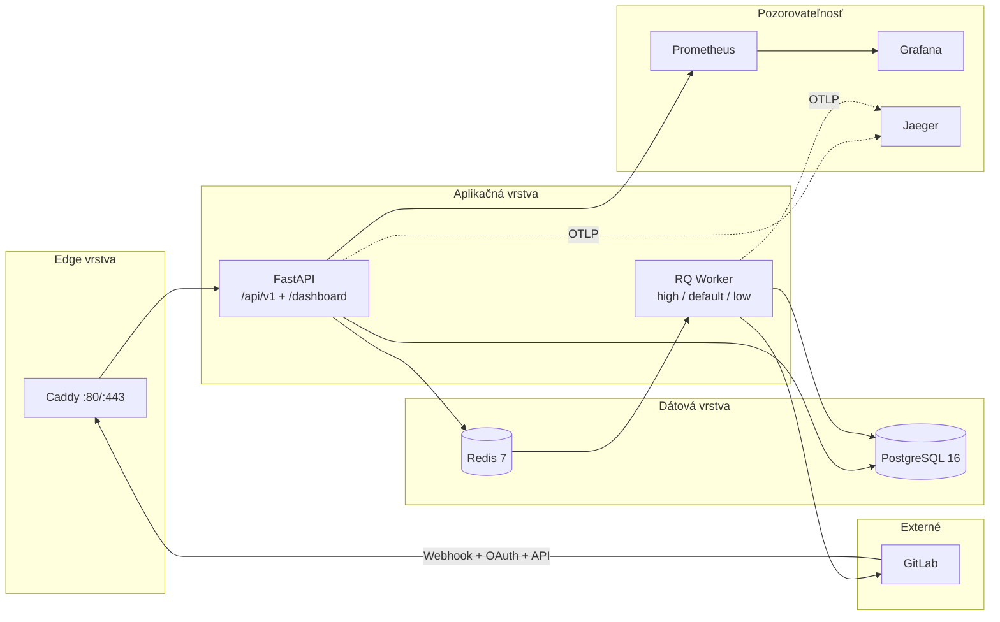
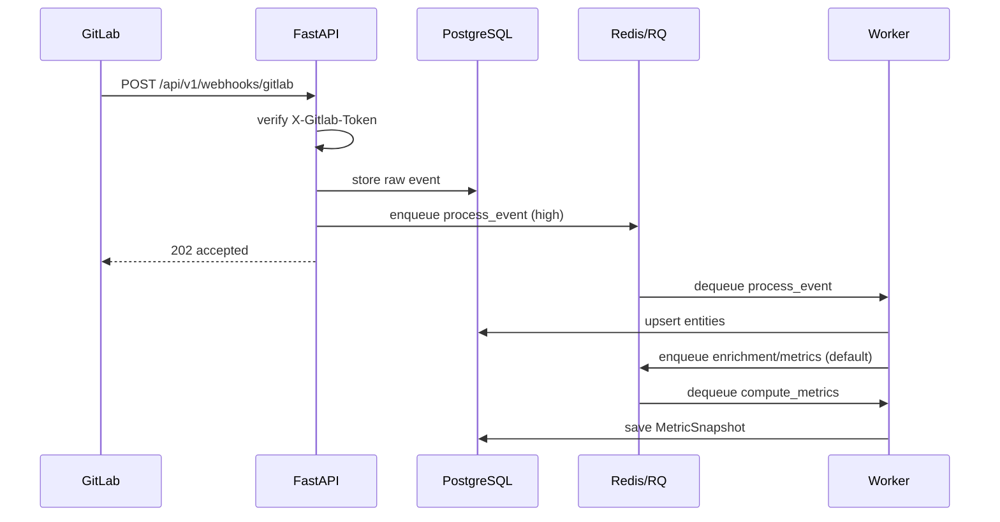
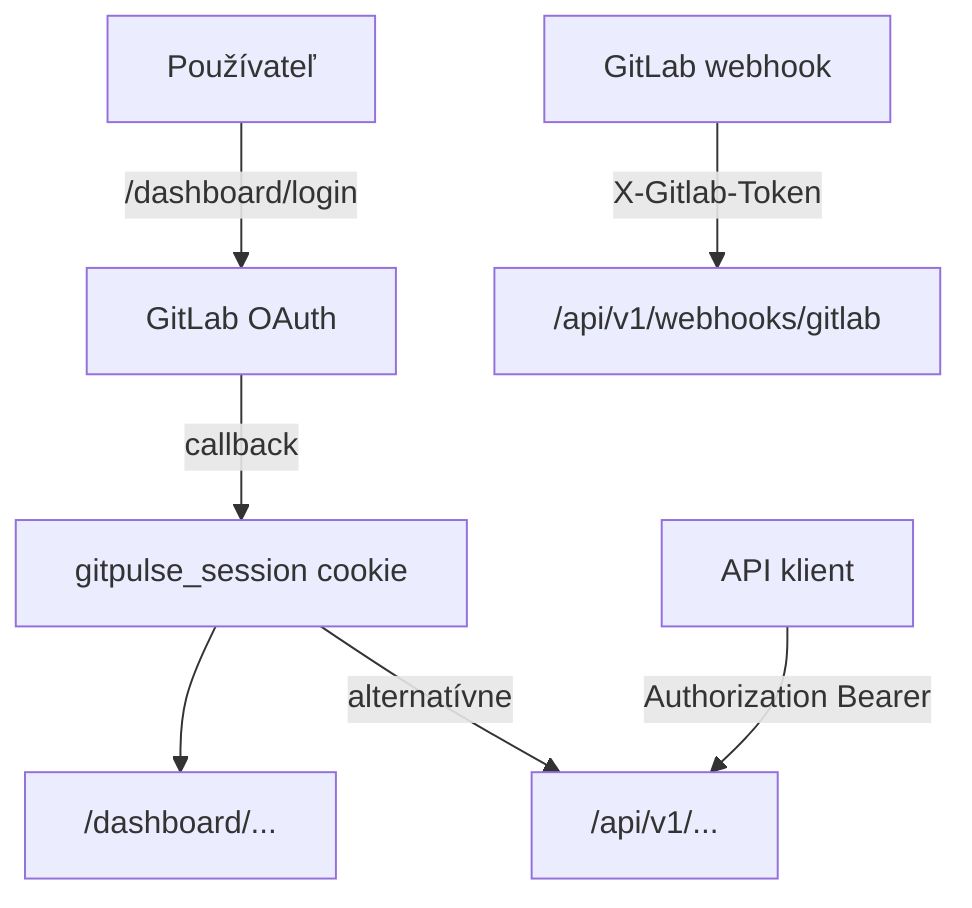


- Pre: Všetci
- Vyžaduje: Nič

> Overené podľa implementácie dňa **2026-09-09**.

## Runtime architektúra

## Komponenty a zodpovednosti

| Komponent | Zodpovednosť |
|---|---|
| `Caddy` | TLS terminácia, reverse proxy na API |
| `FastAPI` | REST API, dashboard routy, health/metrics endpointy |
| `PostgreSQL` | perzistentné dáta (kurzy, tímy, eventy, metriky, support tickety, audit logy) |
| `Redis` | queue backend, locky/idempotencia, krátkodobý cache |
| `RQ Worker` | spracovanie webhookov, enrichment MR/issues, výpočty metrík, snímky súladu, auto-archív, LLM analýza; odložené joby (napr. opakovanie doručenia e-mailu) si plánuje sám job cez `Queue.enqueue_in` a vykoná ich vstavaný RQ scheduler vo workeri |

## Asynchrónny pipeline (webhook -> metriky)

## Architektúra autentifikácie

Autentifikačné vrstvy:

1. Dashboard: GitLab OAuth + podpísaná session cookie.
2. API: Bearer token (`TEACHER_API_TOKEN`) alebo dashboard session.
3. Webhook endpoint: per-project secret (`X-Gitlab-Token`).

## Queue a plánované úlohy

| Queue | Účel | Priorita |
|---|---|---|
| `high` | webhook ingest processing | najvyššia |
| `default` | enrichment, sync, metrics recompute | stredná |
| `low` | snímky súladu, auto-archív, LLM analýza | najnižšia |

Systém **nepoužíva žiadne periodické (cron) joby**. Dáta sa obnovujú výhradne
udalosťami z GitLabu (webhooky) a explicitnými akciami v rozhraní. Údržbové
operácie (napr. čistenie starých eventov, archivácia ukončených kurzov,
re-analýza) sú dostupné ako ručné akcie v *System -> údržbové joby* a spúšťa
ich administrátor podľa potreby. Odložené joby (napr. opakovanie doručenia
e-mailu s exponenciálnym backoffom) si plánuje sám job cez `Queue.enqueue_in`
a vykoná ich vstavaný RQ scheduler vo workeri.

## Deployment model

Produkčný profil používa Docker Compose služby:

- `postgres`
- `redis`
- `api`
- `worker`
- `caddy`

Voliteľný profil `monitoring` pridáva:

- `prometheus`
- `grafana`
- `jaeger`

## Súvisiace stránky

- [API referencia](../api/index.md)
- [Monitoring](../operatori/monitoring.md)
- [Nasadenie](../operatori/nasadenie.md)
