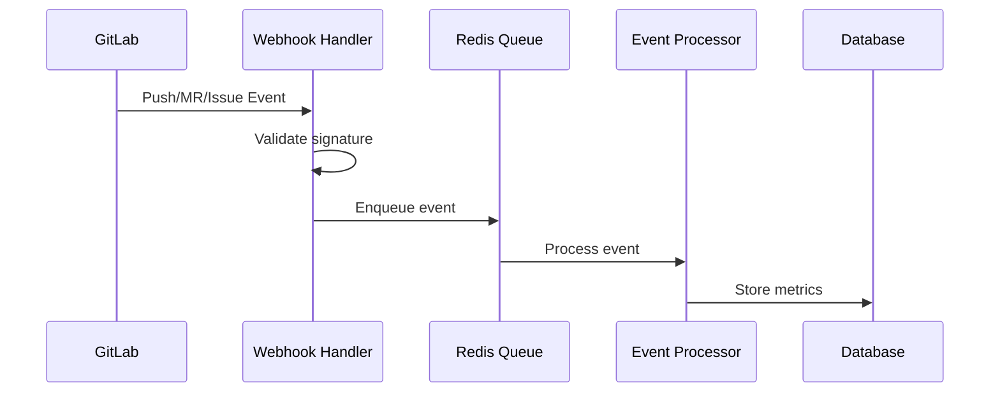
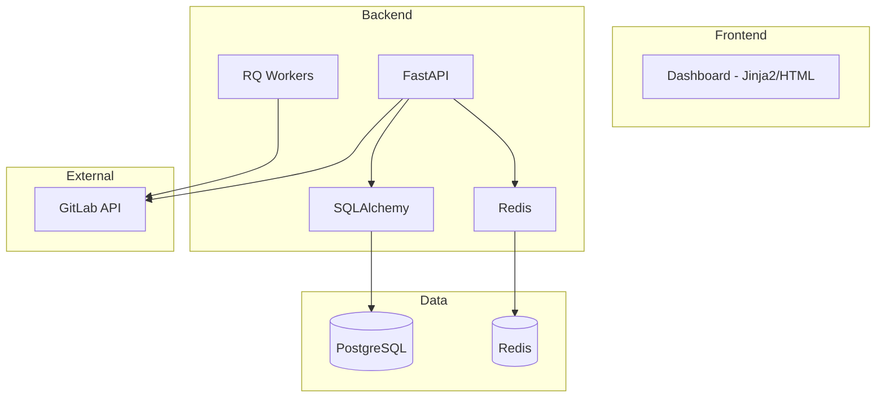


- Pre: Všetci
- Vyžaduje: Nič

## Čo je GitPulse?

**GitPulse** je webová aplikácia, ktorá automaticky analyzuje aktivitu študentov na GitLab projektoch a poskytuje učiteľom objektívne metriky pre hodnotenie tímovej práce a DevOps praktík.

## Cieľová skupina

### Primárni používatelia

| Rola | Použitie |
|------|----------|
| **Učiteľ/Cvičiaci** | Monitorovanie aktivity, hodnotenie, identifikácia problémov |
| **Správca kurzu** | Konfigurácia kurzov, správa používateľov |
| **Operátor** | Nasadenie, údržba, monitoring systému |

### Sekundárni používatelia

- **Študenti** - nepriamy prístup cez transparentné metriky
- **Administrátori** - správa celej inštancie

## Kľúčové funkcie

### 1. Zber dát z GitLab



GitPulse prijíma webhooky z GitLab a spracováva:

- **Push events** - commity, zmeny súborov
- **Merge request events** - vytvorenie, review, merge
- **Note events** - komentáre, code review
- **Pipeline events** - CI/CD builds
- **Issue events** - správa úloh

### 2. Compliance hodnotenie

Systém hodnotí 13 DevOps praktík (R01-R13):

| Kód | Kontrola | Kategória | Váha |
|-----|----------|-----------|------|
| R01 | Issue Assigned | Issue | 8 % |
| R02 | Branch + MR Created | MR | 6 % |
| R03 | Tests Written | MR | 10 % |
| R04 | MR Linked to Issue | MR | 8 % |
| R05 | MR Description | MR | 5 % |
| R06 | Code Review Received | Review | 12 % |
| R07 | Code Review Given | Review | 12 % |
| R08 | Review Response | Review | 10 % |
| R09 | MR Approved | Review | 9 % |
| R10 | Merged by Author | MR | 7 % |
| R11 | MR + Issue Closed | MR | 6 % |
| R12 | Pipeline Green | CI | 7 % |
| R13 | Commit Quality | Commit | 0 % (opt-in) |

### 3. Dashboard a analýza

- **Real-time dashboard** - aktuálny stav všetkých tímov so SSE živými aktualizáciami
- **Team drill-down** - detailná analýza konkrétneho tímu
- **Student detail** - príspevky jednotlivca s rozpisom kontrol
- **Export** - CSV export dát, JSON export/import konfigurácie kurzu
- **LLM analýza** - voliteľná AI analýza merge requestov s redakciou osobných údajov, v produkcii vypnutá
- **E-mailové notifikácie** - automatické oznámenia o kurzoch a hodnotení

## Technologický stack



| Komponent | Technológia | Účel |
|-----------|-------------|------|
| API Server | FastAPI | REST API, webhook handling |
| Database | PostgreSQL | Perzistentné dáta |
| Cache/Queue | Redis | Caching, job queue |
| Workers | RQ (Redis Queue) | Background processing |
| Frontend | Jinja2 + htmx + Alpine.js | Server-side rendering with component macros |

## Nasadenie

GitPulse je navrhnutý pre nasadenie pomocou Docker Compose:

```yaml
services:
  api:           # FastAPI aplikácia
  worker:        # RQ worker (high / default / low)
  postgres:      # Databáza
  redis:         # Cache a queue
  gitpulse-docs: # Dokumentácia (Hugo)
  caddy:         # Reverse proxy s HTTPS
```

GitPulse **nepoužíva scheduler ani cron**. Všetky úlohy sú spúšťané webhookmi
alebo explicitnými akciami v rozhraní.

## Limity a obmedzenia


**Aktuálne obmedzenia.** - Podporuje iba GitLab (nie GitHub, Bitbucket) - Self-hosted GitLab musí byť dostupný z VM - Vyžaduje GitLab API token s dostatočnými právami

## Ďalšie čítanie

- [Architektúra systému](architektura.md) - technické detaily
- [Ciele diplomovej práce](ciele.md) - akademický kontext
- [Príručka pre učiteľov](../ucitelia/index.md) - začíname s GitPulse

