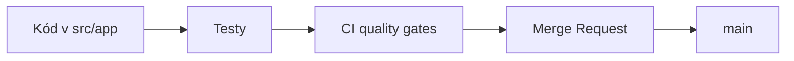


- Pre: Vývojár
- Vyžaduje: Lokálne prostredie podľa príručky pre vývojárov

> Overené podľa repozitára dňa **2026-09-09**.

## Rýchla orientácia



## Kde čo nájsť

| Cesta | Obsah |
|---|---|
| `src/app/api` | route handlery (API + dashboard) |
| `src/app/services` | business logika a integrácie |
| `src/app/workers` | background job spracovanie |
| `src/app/models` | SQLAlchemy modely |
| `src/app/schemas` | Pydantic request/response DTO |
| `src/app/security` | auth, CSRF, token utility |
| `src/app/observability` | logging, metrics, tracing |
| `tests/*` | unit, integration, load testy |

## Lokálne prostredie

```bash
python -m venv .venv
# Linux/macOS: source .venv/bin/activate
# Windows: .venv\Scripts\Activate.ps1

pip install --constraint requirements.lock -e ".[dev,otel]"
docker compose up -d postgres redis
alembic upgrade head
uvicorn app.main:create_app --factory --reload
```

## Povinné quality gates

```bash
ruff check src/ tests/ scripts/
ruff format --check src/ tests/ scripts/
mypy src/app
pytest tests/unit -q
```

CI definícia:

- `.gitlab-ci.yml`

## API a kontrakty

- route inventory: `docs/04-api-spec.md`
- dashboard routy: `src/app/api/dashboard.py`
- health/metrics: `src/app/api/health.py`

## Odporúčaný workflow

1. Vytvoriť branch (`feature/*`, `fix/*`, `refactor/*`).
2. Implementovať zmenu + testy.
3. Prejsť lokálne quality gates.
4. Otvoriť MR s popisom dopadu a testov.
5. Zlúčiť po code review a zelenom CI.

## Dokumentácia

- interné docs: `docs/*`
- docs site (SK/EN): `docs-site/docs/*`
- systémový audit: `docs/00_system_audit_2026-02-15.md`
