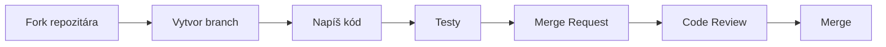
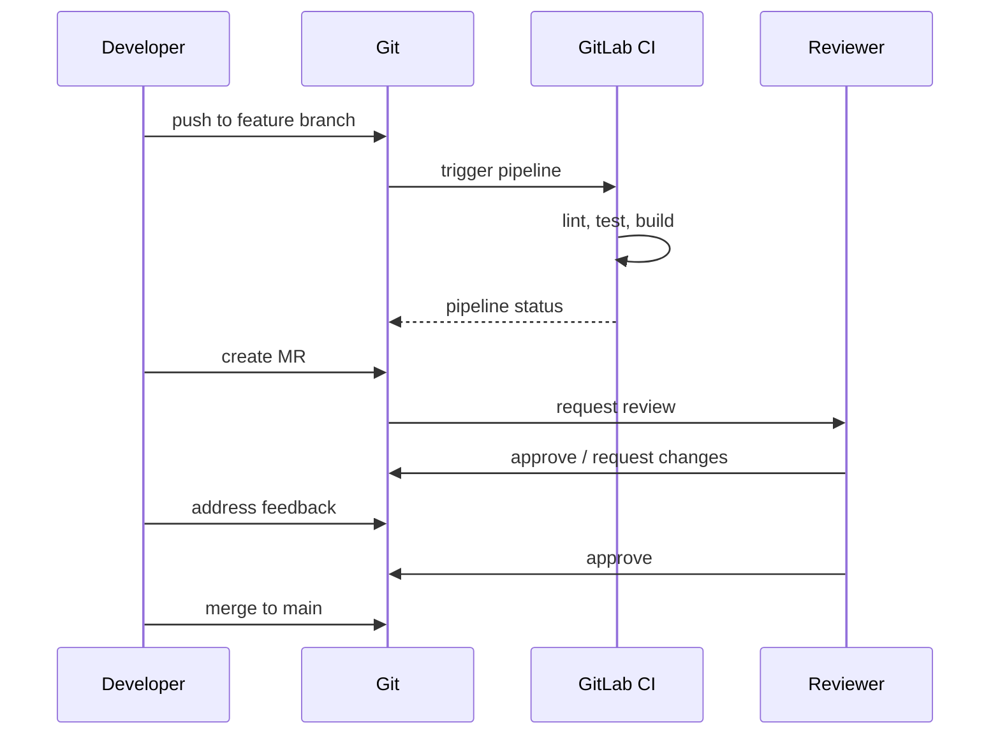
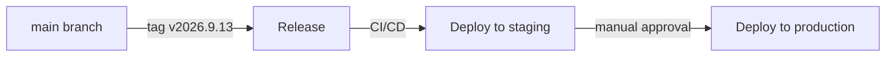


- Pre: Vývojár
- Vyžaduje: Lokálne prostredie podľa príručky pre vývojárov

Ďakujeme za váš záujem prispieť do GitPulse! Táto stránka popisuje proces a konvencie pre prispievanie.

## Proces prispievania



## Rýchly štart

### 1. Fork a klonovanie

```bash
git clone https://gitlab.example.com/kpi-zp/2027/dp.mykyta.olym/workspace/workspace.git gitpulse
cd gitpulse
```

### 2. Vytvorenie branch

```bash
# Synchronizácia s upstream
git fetch upstream
git checkout main
git merge upstream/main

# Nový feature branch
git checkout -b feature/moj-novy-feature
```

### 3. Vývoj

```bash
# Nastavenie prostredia
python -m venv .venv
source .venv/bin/activate
pip install --constraint requirements.lock -e ".[dev,otel]"

# Spustenie testov
pytest

# Linting
ruff check .
ruff format .
```

### 4. Commit a push

```bash
git add .
git commit -m "feat: pridanie novej funkcionality"
git push origin feature/moj-novy-feature
```

### 5. Merge Request

Otvorte MR cez GitLab UI s popisom zmien.

## Konvencie

### Branch naming

| Prefix | Účel | Príklad |
|--------|------|---------|
| `feature/` | Nová funkcionalita | `feature/live-sync-refresh` |
| `fix/` | Oprava bugu | `fix/timeline-sorting` |
| `docs/` | Dokumentácia | `docs/api-examples` |
| `refactor/` | Refaktoring | `refactor/service-layer` |
| `test/` | Testy | `test/compliance-engine` |

### Commit messages

Používame [Conventional Commits](https://www.conventionalcommits.org/):

```
<type>(<scope>): <description>

[optional body]

[optional footer(s)]
```

#### Typy

| Typ | Popis |
|-----|-------|
| `feat` | Nová funkcionalita |
| `fix` | Oprava bugu |
| `docs` | Dokumentácia |
| `style` | Formátovanie (bez zmeny logiky) |
| `refactor` | Refaktoring |
| `test` | Testy |
| `chore` | Údržba, build |

#### Príklady

```bash
# Feature
feat(sync): pridanie live activity refresh po course sync

# Fix
fix(api): oprava 500 error pri prázdnom team

# Docs
docs(readme): aktualizácia inštalačných inštrukcií

# Breaking change
feat(api)!: zmena formátu response pre /metrics

BREAKING CHANGE: response teraz obsahuje nested objekt metrics
```

### Code style

#### Python

Používame [Ruff](https://docs.astral.sh/ruff/) pre linting a formátovanie.

```toml
# pyproject.toml
[tool.ruff]
line-length = 100
target-version = "py312"

[tool.ruff.lint]
select = [
    "E",    # pycodestyle errors
    "W",    # pycodestyle warnings
    "F",    # Pyflakes
    "I",    # isort
    "B",    # flake8-bugbear
    "UP",   # pyupgrade
]

[tool.ruff.lint.isort]
known-first-party = ["app"]
```

#### Príklad dobre formátovaného kódu

```python
"""Team service module.

This module provides business logic for team management.
"""
from datetime import datetime
from typing import Sequence

from sqlalchemy import select
from sqlalchemy.ext.asyncio import AsyncSession

from app.models.team import Team
from app.schemas.team import TeamCreate, TeamUpdate

class TeamService:
    """Service for team-related operations."""
    
    def __init__(self, db: AsyncSession) -> None:
        """Initialize team service.
        
        Args:
            db: Async database session.
        """
        self.db = db
    
    async def get_all(self, course_id: int) -> Sequence[Team]:
        """Get all teams for a course.
        
        Args:
            course_id: The course ID to filter by.
            
        Returns:
            List of teams belonging to the course.
        """
        result = await self.db.execute(
            select(Team)
            .where(Team.course_id == course_id)
            .order_by(Team.name)
        )
        return result.scalars().all()
```

### Testy

Každá nová funkcionalita musí mať testy.

```python
# tests/unit/test_team_service.py
import pytest
from app.services.team_service import TeamService

class TestTeamService:
    """Tests for TeamService."""
    
    @pytest.fixture
    def service(self, db_session):
        return TeamService(db_session)
    
    @pytest.mark.asyncio
    async def test_get_all_returns_teams_for_course(
        self, service, sample_course, sample_team
    ):
        """get_all should return only teams for specified course."""
        # Arrange
        course = await sample_course()
        team1 = await sample_team(course=course)
        team2 = await sample_team(course=course)
        
        # Act
        teams = await service.get_all(course.id)
        
        # Assert
        assert len(teams) == 2
        assert all(t.course_id == course.id for t in teams)
```

## Code Review

### Čo hľadáme

- [ ] Kód je čitateľný a dobre dokumentovaný
- [ ] Testy pokrývajú novú funkcionalitu
- [ ] Žiadne breaking changes bez dokumentácie
- [ ] Commit messages sú popisné
- [ ] CI pipeline prechádza

### Tipy pre autora MR

1. **Malé MR** - Ľahšie sa reviewujú
2. **Popisný title** - Jasne vysvetľuje čo MR robí
3. **Screenshots** - Pre UI zmeny
4. **Self-review** - Prejdite si diff pred odoslaním

### Tipy pre reviewera

1. **Konštruktívna kritika** - Navrhujte riešenia
2. **Prioritizácia** - Odlíšte blocker vs nice-to-have
3. **Testovanie** - Checkout branch a vyskúšajte
4. **Approve promptly** - Neblokujte progress

## Issues

### Vytvorenie issue

```markdown
## Popis
Krátky popis problému alebo požiadavky.

## Kroky na reprodukciu (pre bugy)
1. Krok 1
2. Krok 2
3. ...

## Očakávané správanie
Čo by sa malo stať.

## Aktuálne správanie
Čo sa deje namiesto toho.

## Prostredie
- OS: Ubuntu 22.04
- Python: 3.12.1
- GitPulse verzia: 2026.9.13
```

### Labels

| Label | Popis |
|-------|-------|
| `bug` | Niečo nefunguje |
| `enhancement` | Nová funkcionalita |
| `documentation` | Dokumentácia |
| `good first issue` | Vhodné pre nováčikov |
| `help wanted` | Potrebujeme pomoc |
| `priority: high` | Urgentné |

## Development workflow

### Feature development



### Release process



## Kontakt

- **Maintainer**: [Mykyta Olym](mailto:mykyta.olym.work@gmail.com)
- **GitLab Issues**: Pre bugy a feature requests
- **MS Teams**: Pre rýchle otázky

---


**Prvý príspevok?.** Pozrite si issues označené `good first issue` pre jednoduchšie úlohy na začiatok.

## Ďalšie čítanie

- [Lokálne prostredie](prostredie.md)
- [Štruktúra projektu](struktura.md)
- [Testovanie](testovanie.md)
