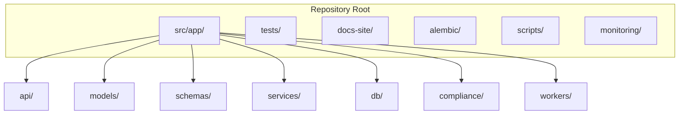
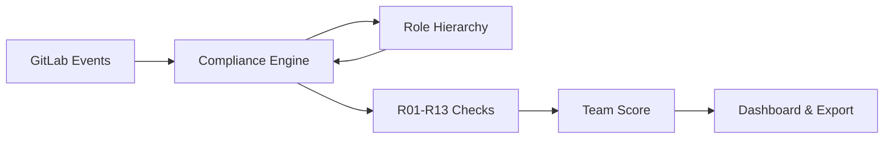


- Pre: Vývojár
- Vyžaduje: Lokálne prostredie podľa príručky pre vývojárov

Prehľad organizácie zdrojového kódu GitPulse.

## Vysokoúrovňový pohľad



## Hlavná štruktúra

```plaintext
gitpulse/
+-- src/app/                    # Hlavný aplikačný kód
|   +-- __init__.py
|   +-- main.py                 # FastAPI aplikácia
|   +-- config.py               # Konfigurácia (pydantic-settings)
|   +-- dependencies.py         # Dependency injection
|   +-- api/                    # HTTP endpointy
|   +-- models/                 # SQLAlchemy ORM modely
|   +-- schemas/                # Pydantic schémy
|   +-- services/               # Business logika
|   +-- db/                     # Database utilities
|   +-- compliance/             # Hodnotenie (compliance checks R01-R13)
|   +-- workers/                # Background tasks (RQ)
|   +-- middleware/             # ASGI middleware (bezpečnosť, rate limit, jazyk, logovanie, chyby)
|   +-- security/               # Sessions, OAuth, CSRF, role, šifrovanie tokenov
|   +-- observability/          # Logovanie, metriky, tracing
|   +-- i18n/                   # Prekladové katalógy
|   +-- utils/                  # Pomocné funkcie
+-- tests/                      # Testy
|   +-- unit/                   # Unit testy
|   +-- integration/            # Integračné testy
+-- alembic/                    # Database migrácie
|   +-- versions/               # Migračné skripty
+-- docs-site/                  # Dokumentácia (Hugo)
+-- scripts/                    # Admin a maintenance skripty
+-- monitoring/                 # Prometheus, Grafana config
+-- docker-compose.yml          # Produkčný compose
+-- Dockerfile                  # API image
+-- pyproject.toml              # Python dependencies
```

## API vrstva

```plaintext
src/app/api/
+-- __init__.py
+-- router.py               # Hlavný router (agreguje všetky endpointy)
+-- health.py               # /health, /ready, /live
+-- courses.py              # Správa kurzov a ich nastavení
+-- course_import.py        # Import skupín a projektov z GitLabu
+-- teams.py                # Správa tímov
+-- projects.py             # Správa projektov
+-- students.py             # Prehľad a detaily študentov
+-- users.py                # Používatelia a ich role
+-- events.py               # GitLab events a audit log
+-- webhooks.py             # Spracovanie prichádzajúcich webhookov
+-- webhook_configs.py      # Konfigurácia multi-scope webhookov
+-- sync.py                 # Spustenie a stav synchronizácie
+-- sse.py                  # Server-Sent Events pre real-time notifikácie
+-- llm.py                  # LLM analýza merge requestov
+-- compliance_history.py   # Týždenná história súladu
+-- observability.py        # Stav služby podľa roly
+-- support.py              # API podpory
+-- helpers/                # Zdieľané routermi, neregistruje žiadnu route
|   +-- sync.py             # Orchestrácia sync, kontrola pripravenosti GitLabu
|   +-- job_guards.py       # Jedna bežiaca úloha na kurz / projekt
|   +-- support_deps.py     # FastAPI dependencies pre podporu
|   +-- utils.py            # Malé utility pre odpovede
+-- dashboard/              # Balík pre server-rendered dashboard
```

### Rozdelenie dashboard package

```plaintext
src/app/api/dashboard/
+-- __init__.py            # Agreguje jeden router na doménový balík
+-- auth.py                # Prihlásenie, odhlásenie, prepnutie jazyka
+-- preferences.py         # Téma, akcent, hustota
+-- _helpers.py            # Spoločné templates, CSRF, role-context helpery
+-- _access.py             # Dashboard access-control helpery
+-- home/                  # Dashboard home
|   +-- routes.py          # Skladanie stránky, sidebar, search
|   +-- stats.py           # Role-specific stat-card SQL
|   +-- context.py         # Role-specific context a sidebar badges
|   +-- changelog.py       # Latest changes záznamy (changelog_entries.json)
|   +-- course_health.py   # Per-course RED-team health pre course cards
|   +-- activity.py, attention.py, semester.py, sync_info.py
+-- courses/               # Stránka kurzu, kontroly, nastavenia
|   +-- routes.py, checks.py, settings.py, settings_config.py, settings_view.py
+-- teams/                 # Stránka tímu, LLM analýza, vylúčenie členov
+-- projects/              # Stránka projektu, LLM analýza
+-- students/              # Stránka študenta: routes.py, diffs.py (diff pohľady, zvýraznenie), notes.py (vlákna)
+-- admin/                 # Používatelia, učitelia kurzov, systém, analytika, udalosti, obohatenie
```

Každý doménový balík je usporiadaný tak, ako GitLab drží
`app/controllers/<domain>/`: `routes.py` skladá stránku, susedné moduly
držia SQL a view modely a `__init__` balíka vystavuje router, ktorý
dashboard agregátor pripája.

### Príklad API endpointu

```python
# src/app/api/courses.py
from fastapi import APIRouter, Depends, HTTPException, status
from sqlalchemy.ext.asyncio import AsyncSession

from app.db.session import get_db
from app.schemas.courses import CourseCreate, CourseResponse
from app.services.courses import CourseService
from app.security.rbac import require_role

router = APIRouter(prefix="/courses", tags=["courses"])

@router.post("/", response_model=CourseResponse, status_code=status.HTTP_201_CREATED)
async def create_course(
    course_data: CourseCreate,
    db: AsyncSession = Depends(get_db),
    _: None = Depends(require_role("admin")),
):
    """Vytvorí nový kurz."""
    service = CourseService(db)
    return await service.create(course_data)
```

## Modely (ORM)

```plaintext
src/app/models/
+-- __init__.py
+-- base.py                       # Základná trieda s timestamps
+-- course.py                     # Model kurzu
+-- course_settings.py            # Konfigurácia pravidiel a prahov kurzu
+-- team.py                       # Model tímu
+-- team_member.py                # Členstvo v tíme a príznak is_mentor
+-- user.py                       # Používatelia a ich preferencie
+-- project.py                    # Mapovanie GitLab projektov
+-- webhook_event.py              # Uložené surové webhook udalosti
+-- commit.py                     # Commity
+-- merge_request.py              # Merge requesty
+-- issue.py                      # Issues
+-- pipeline.py                   # CI/CD pipelines
+-- metric_snapshot.py            # Vypočítané snapshoty metrík
+-- student_compliance_snapshot.py# Týždenné compliance snapshoty študentov
+-- custom_check.py               # Vlastné dynamické kontroly
+-- support_ticket.py             # Požiadavky podpory
+-- email_log.py                  # Audit odoslaných emailov
```

### Príklad modelu

```python
# src/app/models/team.py
from sqlalchemy import String, ForeignKey, Integer
from sqlalchemy.orm import Mapped, mapped_column, relationship

from app.models.base import BaseModel

class Team(BaseModel):
    __tablename__ = "teams"
    
    name: Mapped[str] = mapped_column(String(100))
    course_id: Mapped[int] = mapped_column(ForeignKey("courses.id"))
    gitlab_group_id: Mapped[int | None] = mapped_column(Integer)
    
    # Relationships
    course: Mapped["Course"] = relationship(back_populates="teams")
    members: Mapped[list["TeamMember"]] = relationship(back_populates="team")
    projects: Mapped[list["Project"]] = relationship(back_populates="team")
```

## Schémy (Pydantic)

```plaintext
src/app/schemas/
+-- __init__.py
+-- common.py           # Zdieľané schémy (pagination, filtre)
+-- courses.py          # CourseCreate, CourseResponse
+-- teams.py            # TeamCreate, TeamResponse
+-- users.py            # UserCreate, UserResponse
+-- projects.py         # ProjectResponse
+-- students.py         # StudentResponse, StudentDetail
+-- events.py           # Event schémy
+-- compliance.py       # Schémy histórie súladu
+-- observability.py    # Schémy stavu služby
+-- support.py          # Požiadavky podpory a spätná väzba
+-- llm.py              # Požiadavky a odpovede LLM analýzy
+-- custom_check.py     # Schémy vlastných kontrol
+-- jobs.py             # Background job schémy
+-- webhooks.py         # Webhook payload schémy
```

### Príklad schém

```python
# src/app/schemas/courses.py
from datetime import date
from pydantic import BaseModel, ConfigDict

class CourseBase(BaseModel):
    code: str
    name: str
    academic_year: str
    semester: str

class CourseCreate(CourseBase):
    start_date: date | None = None
    end_date: date | None = None

class CourseResponse(CourseBase):
    model_config = ConfigDict(from_attributes=True)
    
    id: int
    start_date: date | None
    end_date: date | None
    team_count: int = 0
```

## Services (Business logic)

```plaintext
src/app/services/
+-- __init__.py
+-- courses.py              # Správa kurzov a nastavení
+-- member_sync.py          # Synchronizácia členov tímov a kurzov
+-- events.py               # Správa a dotazovanie GitLab udalostí
+-- audit.py                # Zápisy do audit logu
+-- gitlab/                 # Komunikácia s GitLabom
|   +-- client.py           # Asynchrónny GitLab REST API klient
|   +-- cache.py            # Cache vrstva pre GitLab REST API
|   +-- token_health.py     # Kontrola tokenu pred synchronizáciou
+-- gitlab_import/          # Dávkový import GitLab skupín a projektov
|   +-- service.py          # Samotná operácia importu
|   +-- persistence.py, email_enrichment.py, normalize.py, helpers.py
+-- llm/                    # LLM analýza merge requestov (OpenAI, Gemini, Groq)
|   +-- service.py, redaction.py, course_context.py, types.py
+-- email_notifications.py  # Notifikačný emailový subsystém
+-- compliance_history.py   # Týždenné snímky súladu
+-- support_forms.py        # Formuláre spätnej väzby a podpora
+-- job_control.py          # Riadenie životného cyklu background úloh
+-- page_cache.py           # Redis caching stránok a dát
```

### Service pattern

```python
# src/app/services/teams.py
from sqlalchemy.ext.asyncio import AsyncSession
from sqlalchemy import select

from app.models.team import Team
from app.schemas.team import TeamCreate

class TeamService:
    def __init__(self, db: AsyncSession):
        self.db = db
    
    async def get_by_id(self, team_id: int) -> Team | None:
        result = await self.db.execute(
            select(Team).where(Team.id == team_id)
        )
        return result.scalar_one_or_none()
    
    async def create(self, data: TeamCreate, course_id: int) -> Team:
        team = Team(**data.model_dump(), course_id=course_id)
        self.db.add(team)
        await self.db.commit()
        await self.db.refresh(team)
        return team
```

## Compliance engine

```plaintext
src/app/compliance/
+-- __init__.py
+-- engine.py               # Hlavný compliance engine
+-- engine_checks.py        # R01-R13 compliance check implementations
+-- dynamic_checks.py       # Teacher-defined custom check evaluation
+-- roles.py                # GitLab role hierarchy (access levels, scoring gate helpers)
+-- types.py                # Shared types
```

### Hierarchia rolí (`roles.py`)

Modul definuje GitLab access levels (Guest=10, Reporter=20, Developer=30, Maintainer=40, Owner=50)
a pomocné funkcie `access_role_name()`, `is_contributing_role()`, `role_priority()`.

**Scoring gate:** Členovia s rolou nižšou ako Developer (Guest/Reporter) a nulovú
aktivitou nie sú zahrnutí do tímového agregátu. Rovnako sú vylúčení dedení
členovia (inherited group members) bez aktivity, bez ohľadu na úroveň prístupu.



## Workers (Background tasks)

```plaintext
src/app/workers/
+-- __init__.py
+-- sync_job.py             # Úplná GitLab synchronizácia tímu
+-- sync_project_job.py     # Synchronizácia jednotlivého projektu
+-- metrics_job.py          # Prepočet compliance metrík (R01-R13)
+-- event_processor.py      # Asynchrónne spracovanie prichádzajúcich webhookov
+-- enrich_mr.py            # REST API obohatenie detailov merge requestov
+-- enrich_issue.py         # REST API obohatenie detailov issues
+-- llm_job.py              # Asynchrónne volania LLM analýzy
+-- sweep.py                # Pravidelné údržbové čistenia a sweepy
```

### Worker príklad

```python
# src/app/workers/sync_job.py
import redis
from rq import Queue

redis_conn = redis.from_url("redis://localhost:6379/0")
queue = Queue("default", connection=redis_conn)

# Zaradenie úlohy do frontu
job = queue.enqueue("app.workers.sync_job.sync_team", team_id=123)
```

## Testy

```plaintext
tests/
+-- __init__.py
+-- conftest.py             # Pytest fixtures
+-- unit/                   # Unit testy (bez external deps)
|   +-- test_compliance_engine.py
|   +-- test_roles.py               # 36 testov pre role hierarchy
|   +-- test_webhook_edge_cases.py     # Webhook edge-case testy
+-- integration/            # Integračné testy
    +-- test_api_courses.py
    +-- test_api_teams.py
    +-- test_gitlab_sync.py
```

## Frontend architektúra

Dashboard používa server-side rendering (Jinja2) obohatený o htmx pre parciálne
aktualizácie a Alpine.js pre klientskú reaktivitu. Všetok frontend kód je
organizovaný podľa komponentovej architektúry.

### Šablóny (Templates)

```plaintext
src/app/templates/
+-- base.html                    # Minimálny shell (~80 riadkov)
+-- components/                  # 23 znovupoužiteľných Jinja2 makier
|   +-- icons.html               #   SVG ikony
|   +-- buttons.html             #   Tlačidlá (primary, danger, icon)
|   +-- badges.html              #   Status badges, traffic light
|   +-- modals.html              #   Modal & drawer dialógy
|   +-- forms.html               #   Formulárové polia
|   +-- alerts.html              #   Alert banery
|   +-- cards.html               #   Karty a metriky
|   +-- layout.html              #   Page header, breadcrumbs
|   +-- loaders.html             #   Spinner, block loading
|   +-- tables.html              #   Triediteľné tabuľky
|   +-- toasts.html              #   Toast notifikácie
|   +-- header.html              #   Navigačný bar
|   +-- import_helpers.html      #   Markup GitLab import modalu
|   +-- _config_import_body.html #   Telo modalu importu konfigurácie
|   +-- feature_flags.html       #   Feature flag makrá
+-- errors/                      # Chybové stránky (403, 404, 500)
+-- static/
|   +-- styles.css               # Entry point - @import 18 CSS súborov
|   +-- css/                     # 18 komponentových CSS súborov
|   |   +-- tokens.css           #   Design tokens (farby, spacing)
|   |   +-- buttons.css          #   Štýly tlačidiel
|   |   +-- badges.css           #   Štýly badges
|   |   +-- cards.css            #   Štýly kariet
|   |   +-- modals.css           #   Modal & drawer štýly
|   |   +-- responsive.css       #   Mobile (≤768px) + phone (≤480px)
|   |   +-- ...                  #   (toasts, alerts, forms, tables, ...)
|   +-- js/                      # Zdroje JS (build ide do dist/)
|       +-- _parts/core/         #   core.bundle.js: CSRF, apiCall, toast, modal, job bar, guardy
|       +-- components.js        #   Paginator, TableFilter, forms
|       +-- sse-stream.js        #   SSE streaming s fallback
|       +-- import-stream.js     #   SSE lifecycle GitLab importu
|       +-- gitlab-helpers.js    #   GitLab URL parsing
|       +-- pages/               #   Stránkové kontrolery
+-- *.html                       # 20 stránkových šablón
```

### Použitie makier

Šablóny používajú Jinja2 `` importy na skladanie stránok:

```jinja2




{{ btn("Uložiť", variant="primary") }}
{{ modal("editModal", "Upraviť tím") }}
```

### Knižnice CDN

| Knižnica | Verzia | Účel |
|----------|--------|------|
| htmx | 1.9.12 | Parciálne aktualizácie |
| Alpine.js | 3.x | Klientská reaktivita |
| Flatpickr | latest | Výber dátumu |
| Tom Select | 2.3.1 | Combo box |
| Tippy.js | 6.x | Tooltipy |

## Konvencie

### Import ordering

```python
# 1. Standard library
from datetime import datetime
from typing import Any

# 2. Third-party
from fastapi import APIRouter
from sqlalchemy.ext.asyncio import AsyncSession

# 3. Local imports
from app.models.team import Team
from app.services.teams import TeamService
```

### Naming conventions

| Typ | Konvencia | Príklad |
|-----|-----------|---------|
| Moduly | `snake_case` | `member_sync.py` |
| Triedy | `PascalCase` | `TeamService` |
| Funkcie | `snake_case` | `get_team_metrics` |
| Konštanty | `UPPER_SNAKE` | `MAX_TEAM_SIZE` |
| Endpointy | `kebab-case` | `/api/v1/courses/{course_id}/sync-all` |

## Ďalšie čítanie

- [Testovanie](testovanie.md)
- [Databázové migrácie](migracie.md)
- [Prispievanie](prispievanie.md)
