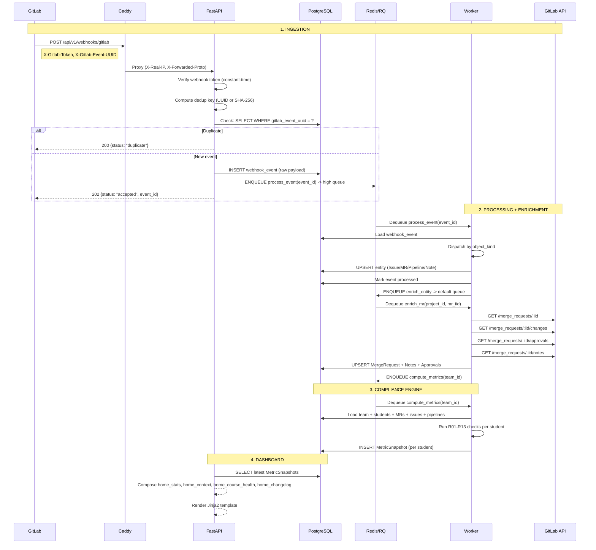

# 2. Architecture & Diagrams

> **Documentation Status (2026-05-31):** Verified against current implementation.
> - **Source of truth (API):** `src/app/api/*`, `src/app/schemas/*`, runtime `/openapi.json`.
> - **Source of truth (CI/quality gates):** `.gitlab-ci.yml`, `pyproject.toml`.
> - **Local gate baseline:** `python scripts/build_bundle.py --check`, `python scripts/check_static_artifacts.py`, `ruff check src tests scripts`, `ruff format --check src tests scripts`, `mypy src/app`, `pytest -q`.


## 2.0 Source Layout

The package follows the layering GitLab uses for its Rails application, in
the Python/FastAPI equivalents. One responsibility per package, one domain
per sub-package; a module's name says what it holds, never its mechanism
(`admin/system.py`, not `admin_system_routes.py`).

| GitLab (`app/`)      | GitPulse (`src/app/`)           | Holds |
|----------------------|---------------------------------|-------|
| `controllers/<domain>/` | `api/dashboard/<domain>/`    | HTML pages: `home/`, `courses/`, `teams/`, `projects/`, `students/`, `admin/`, plus `auth.py`, `preferences.py`. Each package exposes its router from `__init__.py`; `_helpers.py`, `_access.py`, `_stats.py` are the shared page helpers (GitLab's `controllers/concerns/`). |
| `lib/api/`           | `api/`                          | The JSON API (`/api/v1`): one flat router module per resource (`courses.py`, `teams.py`, `sync.py`, `course_import.py`, ...), `router.py` aggregating them, `exception_handlers.py`, `contracts.py`, `errors.py`. |
| `lib/api/helpers/`   | `api/helpers/`                  | What the routers share without registering a route: `sync.py` (orchestration, GitLab readiness), `job_guards.py`, `support_deps.py`, `utils.py`. |
| `services/<domain>/` | `services/`                     | Business operations, one module or package per domain: `courses.py`, `member_sync.py`, `events.py`, `audit.py`, `gitlab/` (client, cache, token health), `gitlab_import/` (the group import and its parts), `llm/` (provider client, redaction, course context). `*_types.py` / `types.py` siblings hold a service's dataclasses and protocols. |
| `finders/`           | `db/repositories/`              | Query objects (`base.py`, `event_repo.py`, `project_repo.py`); `db/session.py` is the engine and session factory. |
| `models/`            | `models/`                       | SQLAlchemy models, one per table. |
| `serializers/`       | `schemas/`                      | Pydantic request/response models, one module per resource. |
| `policies/`          | `security/`                     | Sessions, OAuth, CSRF, roles, rate limits, token encryption. |
| `workers/`           | `workers/`                      | RQ jobs (`sync_job.py`, `event_processor.py`, `llm_job.py`, sweeps) and their shared `progress.py` / `idempotency.py`. |
| `helpers/`           | `template_helpers.py`, `i18n/`  | Jinja globals and filters, the translation catalogue. |
| `lib/gitlab/middleware/` | `middleware/`               | The ASGI middlewares, one module each (security headers, rate limit, correlation id, locale, request logging, performance, error boundary) and the error pages they render. |
| `lib/`               | `utils/`, `compliance/`, `observability/` | Pure helpers (semester calendar, GitLab patterns, time), the compliance engine, logging / metrics / tracing. |
| `assets/`            | `templates/static/`             | CSS (`tokens.css` and one file per component / page), JS (`_parts/` concatenated into `core.bundle.js` and `pages/*.js` by `scripts/build_bundle.py`). |

Routes register in one place each: `main.py` mounts `api.router` under
`/api/v1` and `api.dashboard.router` under `/dashboard`; every domain package
aggregates its own routers in its `__init__.py`.

## 2.1 Component Diagram

```
+------------------------------------------------------------------------------+
|                        Production Stack (Docker Compose)                      |
|                                                                              |
|  +---------+    +--------------------------------------------------------+  |
|  |  Caddy  |---▶|                   FastAPI API                          |  |
|  | :80/443 |    |                                                        |  |
|  |  (TLS)  |    |  /api/v1/webhooks/gitlab  <--- GitLab (webhook token)   |  |
|  +---------+    |  /api/v1/courses          <--- Admin (Bearer token)     |  |
|       |         |  /api/v1/teams            <--- Admin (Bearer token)     |  |
|       |         |  /api/v1/students         <--- Admin (Bearer token)     |  |
|       |         |  /api/v1/projects         <--- Admin (Bearer token)     |  |
|       |         |  /api/v1/users            <--- Admin only (Bearer)      |  |
|       |         |  /api/v1/sync/*           <--- Teacher+ (Bearer token)  |  |
|       |         |  /api/v1/llm/*            <--- Authenticated (Bearer)   |  |
|       |         |  /dashboard/*             <--- Teacher (GitLab OAuth)   |  |
|       |         |  /health, /metrics        <--- internal probes/scrapes  |  |
|       |         +------------+-------------------------------------------+  |
|       |                      |                                               |
|       |                      ▼                                               |
|       |         +--------------------+    +-----------------------------+   |
|       |         |   Redis 7          |◀--▶|   RQ Worker                 |   |
|       |         |   (Queue + Cache)  |    |   (3 priority queues)       |   |
|       |         +--------------------+    |   high: webhooks            |   |
|       |                                   |   default: enrichment       |   |
|       |         +--------------------+    |   low: reports              |   |
|       |         |   rq-scheduler     |---▶+-----------------------------+   |
|       |         |   (periodic jobs)  |                                      |
|       |         +--------------------+                                      |
|       |                                                                      |
|       +--------▶+--------------------+                                      |
|                 |   PostgreSQL 16    |◀---- Worker + API                    |
|                 |   (primary store)  |                                      |
|                 +--------------------+                                      |
|                                                                              |
|  Optional (--profile monitoring):                                           |
|  +-----------+  +-----------+                                              |
|  | Prometheus|  |  Jaeger   |                                              |
|  |   :9090   |  |  :16686   |                                              |
|  +-----------+  +-----------+                                              |
+------------------------------------------------------------------------------+

External:
+---------------+
|  TUKE GitLab  |--webhook POST--▶ Caddy :443/api/v1/webhooks/gitlab
|  (gitlab.kpi) |◀--REST API------ Worker (enrichment jobs)
|               |◀--OAuth2-------- Dashboard login
+---------------+
```

## 2.2 Authentication Architecture

```
+-----------------------------------------------------------------------------+
|                        Authentication Layers                                 |
+-----------------------------------------------------------------------------+
|                                                                             |
|  +---------------------------------------------------------------------+   |
|  | 1. GitLab OAuth (Dashboard)                                          |   |
|  |    Flow: /dashboard/login -> GitLab -> /dashboard/oauth/callback       |   |
|  |    Session: Redis-backed opaque cookie (HttpOnly, Secure, SameSite)   |   |
|  |    Expiry: 30 days idle, 90 days absolute                            |   |
|  |                                                                       |   |
|  |    Role Assignment (priority order):                                  |   |
|  |    1. Username in GITLAB_ADMIN_USERNAMES -> admin                     |   |
|  |    2. Username in GITLAB_TEACHER_USERNAMES -> teacher                 |   |
|  |    3. Member of group in GITLAB_TEACHER_GROUP_IDS -> teacher          |   |
|  |    4. Any authenticated GitLab user -> student                         |   |
|  +---------------------------------------------------------------------+   |
|                                                                             |
|  +---------------------------------------------------------------------+   |
|  | 2. Bearer Token (API)                                                |   |
|  |    Header: Authorization: Bearer <TEACHER_API_TOKEN>                 |   |
|  |    Verification: hmac.compare_digest() (constant-time)               |   |
|  |    Used by: All /api/v1/* endpoints (except webhooks)                |   |
|  |                                                                       |   |
|  |    Auth Levels:                                                       |   |
|  |    - ApiAuth: Any valid Bearer token OR session                      |   |
|  |    - ApiTeacherAuth: Bearer OR session with teacher/admin role       |   |
|  |    - ApiAdminAuth: Bearer OR session with admin role                 |   |
|  +---------------------------------------------------------------------+   |
|                                                                             |
|  +---------------------------------------------------------------------+   |
|  | 3. Webhook Token (GitLab Webhooks)                                   |   |
|  |    Header: X-Gitlab-Token                                            |   |
|  |    Per-project secret generated at registration                      |   |
|  |    Verification: bcrypt.checkpw() (constant-time)                    |   |
|  +---------------------------------------------------------------------+   |
|                                                                             |
+-----------------------------------------------------------------------------+
```

## 2.3 Event Flow: Webhook -> Processing -> Metrics



## 2.4 Compliance Engine Architecture

```
+-----------------------------------------------------------------------------+
|                         Compliance Engine                                    |
+-----------------------------------------------------------------------------+
|                                                                             |
|  Input: Student's GitLab activity (MRs, commits, issues, reviews, CI)       |
|                                                                             |
|  +-----------------------------------------------------------------------+ |
|  | R01-R13 Compliance Checks                                              | |
|  |                                                                         | |
|  |  R01: Issue Assigned (≥ min_issues assigned issues)                    | |
|  |  R02: Branch + MR (authored MR with valid branch naming)               | |
|  |  R03: Tests Written (authored MR with test changes)                    | |
|  |  R04: MR Linked to Issue (MR references an issue)                     | |
|  |  R05: MR Description (MR follows template)                            | |
|  |  R06: Review Received (distinct reviewers on own MRs)                 | |
|  |  R07: Code Review Given (distinct MRs reviewed meaningfully)          | |
|  |  R08: Review Response (response rate + commit-ref response)           | |
|  |  R09: MR Approved (distinct approvers on own MR)                      | |
|  |  R10: Merged by Author (authored MR merged by student)                | |
|  |  R11: MR + Issue Closed (merged/closed MR and closed issue)           | |
|  |  R12: Pipeline Green (CI pipeline with success + test job)            | |
|  |  R13: Commit Quality (web-editor ratio ≤ threshold)                   | |
|  +-----------------------------------------------------------------------+ |
|                             |                                               |
|                             ▼                                               |
|  Output: MetricSnapshot (traffic-light status, scores, check details)       |
|                                                                             |
+-----------------------------------------------------------------------------+
```

## 2.5 Idempotency Strategy

Three layers prevent duplicate processing:

```
+-----------------------------------------------------------------------------+
| Layer 1: Event Dedup (DATABASE)                                             |
|   webhook_events.gitlab_event_uuid has UNIQUE constraint                    |
|   -> INSERT fails on duplicate -> return "duplicate" to GitLab                |
+-----------------------------------------------------------------------------+
| Layer 2: Entity Upsert (DATABASE)                                           |
|   All entity tables use UPSERT (INSERT ON CONFLICT UPDATE)                  |
|   -> Re-processing same event overwrites with same data (safe)               |
+-----------------------------------------------------------------------------+
| Layer 3: Job Dedup (REDIS)                                                  |
|   @idempotent_job decorator: Redis SET NX with 10-min TTL                   |
|   -> Same job_id within 10 min -> skip (performance optimization)             |
+-----------------------------------------------------------------------------+
```

## 2.6 Failure Modes & Recovery

| Failure | Detection | Recovery |
|---------|-----------|----------|
| Redis down during enqueue | `try/except` in webhook handler | Event stored in DB; sweep job (15 min) re-enqueues |
| Worker crash mid-job | RQ job timeout (5 min) | RQ auto-retries: 3 attempts with backoff |
| GitLab API 429/5xx | httpx exception | Job retry; webhook/manual sync can be retried explicitly |
| PostgreSQL down | DB connection error | API returns 503; health check marks `degraded` |
| Backend unreachable | Client health monitor | All SSE streams & polling paused; auto-resume on recovery |
| OOM in worker | Docker memory limit | Container auto-restarts (`restart: unless-stopped`) |
| Circuit open (GitLab) | 5+ failures | Circuit breaker opens; recovers after 60s |

## 2.7 Data Retention Policy

| Data | Retention | Mechanism |
|------|-----------|-----------|
| Raw webhook events | 90 days | `cleanup_old_events` scheduled job |
| Enriched entities | End of academic year | Manual purge via admin API |
| Metric snapshots | Indefinite | ~1 KB per student per computation |
| Generated reports | 90 days | `cleanup_old_reports` scheduled job |
| Dead-letter events | Auto-resurrect | `sweep_dlq_auto_resurrect` (6 hours) |
| Audit log | 1 year | Manual purge |
| LLM analysis logs | 1 year | Manual purge |
| Backups | 30 days | `backup.sh` auto-prune |

## 2.8 Feature Flag Architecture

```
+-----------------------------------------------------------------------------+
|                          Feature Flags                                       |
+-----------------------------------------------------------------------------+
|                                                                             |
|  Core Features (enabled by default):                                        |
|  +-- FEATURE_RBAC                  Role-based access control                |
|  +-- FEATURE_EVENT_PIPELINE        DLQ, replay, audit log                   |
|  +-- FEATURE_SECURITY_HARDENING    CSRF + rate limiting                     |
|  +-- FEATURE_GITLAB_CACHE          ETag-based caching                       |
|  +-- FEATURE_BACKPRESSURE          Queue rate limiting                      |
|  +-- FEATURE_EMAIL_NOTIFICATIONS   Email (tickets, role changes, courses)   |
|                                                                             |
|  Optional Features (disabled by default):                                   |
|  +-- FEATURE_LLM_SUGGESTIONS       AI-powered analysis                      |
|  +-- FEATURE_MULTI_TENANT          Multi-semester clone/archive             |
|  +-- FEATURE_SUPPORT_FORMS         Dynamic form builder + ticket viewer     |
|                                                                             |
+-----------------------------------------------------------------------------+
```

## 2.9 Network Architecture

```
+-----------------------------------------------------------------------------+
|                     Docker Network Isolation                                 |
+-----------------------------------------------------------------------------+
|                                                                             |
|  +---------------------------------------------------------------------+   |
|  | frontend network                                                     |   |
|  |   Caddy ◀--▶ API                                                    |   |
|  |   (public: 80, 443)                                                  |   |
|  +---------------------------------------------------------------------+   |
|                                                                             |
|  +---------------------------------------------------------------------+   |
|  | backend network                                                      |   |
|  |   API ◀--▶ Worker ◀--▶ Redis ◀--▶ Scheduler                         |   |
|  |   (internal only)                                                    |   |
|  +---------------------------------------------------------------------+   |
|                                                                             |
|  +---------------------------------------------------------------------+   |
|  | data network                                                         |   |
|  |   API ◀--▶ Worker ◀--▶ PostgreSQL                                   |   |
|  |   (internal only, no external access)                                |   |
|  +---------------------------------------------------------------------+   |
|                                                                             |
|  Port bindings:                                                             |
|  - Caddy 80/443: Public (Let's Encrypt + reverse proxy)                    |
|  - All other ports: 127.0.0.1 only                                         |
|  - /metrics: Blocked from public by Caddy                                  |
|                                                                             |
+-----------------------------------------------------------------------------+
```

## 2.10 Frontend Architecture

The teacher dashboard is a server-rendered Jinja2 application enhanced with htmx
for partial updates and Alpine.js for client-side reactivity. All frontend code
follows a component-based architecture with clear separation between templates,
styles, and scripts.

### Technology Stack

| Layer | Technology | Version |
|-------|-----------|---------|
| Templates | Jinja2 macros | - |
| Partial updates | htmx | 1.9.12 |
| Client reactivity | Alpine.js | 3.x |
| Date pickers | Flatpickr | latest |
| Combo boxes | Tom Select | 2.3.1 |
| Tooltips | Tippy.js + Popper | 6.x |

### Template Architecture

```
templates/
+-- base.html                   # Minimal shell (~80 lines)
|   +-- <head>: single CSS entry + CDN libs
|   +-- navbar (via header.html macro)
|   +-- global job bar div
|   +-- 
|   +-- footer + cookie consent
|   +-- 6 × <script> modules (cache-busted ?v=)
|
+-- components/                 # 23 reusable Jinja2 macro files
|   +-- icons.html              #   SVG icon macros
|   +-- buttons.html            #   btn, btn_icon, btn_group
|   +-- badges.html             #   status_badge, traffic_light
|   +-- modals.html             #   modal, drawer, confirm_dialog
|   +-- forms.html              #   form_field, select, file_upload
|   +-- alerts.html             #   alert, callout
|   +-- cards.html              #   card, stat_card, metric_card
|   +-- layout.html             #   page_header, section, breadcrumbs
|   +-- loaders.html            #   loader, block_loading, sk_table_loading
|   +-- tables.html             #   data_table, sortable_header
|   +-- toasts.html             #   toast container
|   +-- header.html             #   top bar macro (avatar + breadcrumb)
|   +-- sidebar.html            #   sidebar navigation macro
|   +-- details.html            #   detail page helpers
|   +-- lists.html              #   list components
|   +-- members.html            #   member display macros
|   +-- cookie_banner.html      #   cookie consent banner
|   +-- support_badges.html     #   support status badges
|   +-- import_helpers.html     #   GitLab import modal markup
|   +-- _config_import_body.html#   config import modal body
|   +-- feature_flags.html      #   Feature gate macros
|
+-- partials/                   # 34 extracted page fragments
|   +-- project/                #   project-detail partials (_ai_analysis, _detail_content, ...)
|   +-- student/                #   7 partials (_merge_requests, _comments, ...)
|   +-- dashboard/              #   5 partials (_courses_grid, _modals, _sidebar, ...)
|   +-- course/                 #   5 partials (_activity_content, _analytics_content, ...)
|   +-- support/                #   4 partials (_course_picker, _form_content, ...)
|   +-- team/                   #   2 partials (_detail_content, _modals)
|   +-- course_settings/        #   2 partials (_modals, _danger_zone)
|
+-- errors/                     # Standalone error pages (403, 404, 500)
|   +-- error_base.html         #   Shared error layout
|
+-- 23 page templates           # dashboard, course_*, team_*, etc.
```

Templates use `` to compose pages from
reusable building blocks. Each page template extends `base.html` and fills the
`content` block. Page-specific scripts go in ``.

### CSS Architecture

A single entry point (`styles.css`) imports 37 component files:

```
static/styles.css              # Entry point - @import only
+-- css/
    +-- tokens.css             # Design tokens: colors, spacing, radii, shadows
    +-- cookie-banner.css      # Cookie consent banner
    +-- buttons.css            # .btn, .btn-primary, .btn-danger, .btn-icon
    +-- badges.css             # .badge, .traffic-light, .status-dot
    +-- cards.css              # .card, .stat-card, .metric-card
    +-- modals.css             # .modal-overlay, .drawer-overlay
    +-- toasts.css             # .toast, .toast-container
    +-- alerts.css             # .alert, .callout
    +-- forms.css              # .form-group, .form-field, inputs
    +-- tables.css             # .data-table, .sortable-header
    +-- loaders.css            # .gp-spinner, .gp-block-loading, .is-refreshing
    +-- layout.css             # .main-container, .page-header, .section
    +-- home.css               # Dashboard home (extracted from layout.css)
    +-- animations.css         # @keyframes fadeIn, slideIn, etc.
    +-- utilities.css          # .text-muted, .mt-*, .flex-*, .sr-only
    +-- auth.css               # Login page styles
    +-- navbar.css             # .navbar, mobile hamburger
    +-- sidebar.css            # Sidebar navigation
    +-- topbar.css             # Top bar (extracted from sidebar.css)
    +-- search-palette.css     # Search palette shell (backdrop, panel, field band)
    +-- dropdowns.css          # Dropdown menus
    +-- scrollbar.css          # Custom scrollbar styles
    +-- pages/                 # Per-page overrides (replaces single pages.css)
    |   +-- shared.css         #   Shared page styles
    |   +-- analysis.css       #   Analysis page
    |   +-- admin.css          #   Admin pages
    |   +-- student.css        #   Student detail
    |   +-- project.css        #   Project detail
    |   +-- course.css         #   Course pages
    |   +-- analytics.css      #   Analytics views
    |   +-- support.css        #   Support forms
    |   +-- misc.css           #   Miscellaneous page styles
    +-- responsive.css         # Mobile (≤768px) + small phone (≤480px)
    +-- vendor.css             # Flatpickr, Tom Select, Tippy overrides
```

All CSS uses custom properties from `tokens.css` for theming. Media queries in
`responsive.css` handle full-width mobile navigation, stacked buttons,
full-viewport modals/drawers, and compact card layouts.

### JavaScript Module Architecture

23 JS files (6 core modules loaded from `base.html` + 17 page/feature modules):

```
static/js/
+-- core.js              # Foundation layer (~1730 lines)
|   +-- _csrfToken       # Auto-read from <meta name="csrf-token">
|   +-- apiCall()        # Fetch wrapper with CSRF + error handling
|   +-- showToast()      # Toast notification system
|   +-- openModal()      # Modal/drawer open with focus trap
|   +-- closeModal()     # Close modal by ID (checks modal guards)
|   +-- forceCloseModal()# Close bypassing guards
|   +-- registerModalGuard() # Per-modal close guard callback
|   +-- enableFormDirtyGuard() # Auto-detect dirty forms in modals
|   +-- clearModalDirty()# Clear modal form dirty snapshots
|   +-- closeAllModals() # Close everything on Escape
|   +-- addDirtyReason() # Register page-level dirty state
|   +-- clearDirtyReason() # Clear a dirty state reason
|   +-- hasUnsavedState()# Check all dirty reasons + modals + global jobs
|   +-- skipBeforeunload() # Bypass guard for programmatic navigations
|   +-- debounce()       # Utility debounce
|   +-- copyToClipboard()
|   +-- registerShortcut()
|   +-- initTooltips()   # Tippy.js initialization
|   +-- initFlatpickr()  # Date picker initialization
|   +-- glFormSelect()   # Alpine <select> replacement component
|   +-- acceptCookies() / declineCookies()
|
+-- components.js        # Reusable UI components (~1080 lines)
|   +-- ClientPaginator  # Client-side pagination class
|   +-- TableFilter      # Real-time table search class
|   +-- FilterPills      # Active filter pill display
|   +-- PollingController # Start/stop interval polling
|   +-- submitModalForm()# Generic modal form submission
|   +-- initWeightValidator()
|   +-- initFileUploadArea()
|   +-- confirmDangerousAction()
|   +-- addUsernameToInput() / removeUsernameFromInput()
|   +-- toggleSelectAll()# Table checkbox toggle
|
+-- global-job-bar.js    # Multi-job progress system (~940 lines)
|   +-- showGlobalJob()  # Start a new job in the bar
|   +-- updateGlobalJob()# Update progress/status
|   +-- completeGlobalJob()
|   +-- hideGlobalJob()
|   +-- deferGlobalJob() # Defer job (show only if modal closes first)
|   +-- promoteGlobalJob() # Promote deferred job to visible
|   +-- isGlobalJobRunning()
|   +-- confirmProcessRestart()
|   +-- startCourseSyncPolling()
|   +-- restoreGlobalJobBar()  # Restore on page load
|
+-- sse-stream.js        # Server-Sent Events (~200 lines)
|   +-- streamJobProgress()  # SSE with polling fallback + health-aware
|
+-- health-monitor.js    # Client-side health monitor (~300 lines)
|   +-- GP.health.getState() # Returns current health snapshot
|   +-- GP.health.check()   # Force an immediate health check
|   +-- GP.health.isDown    # Boolean getter - true when backend unreachable
|   +-- gp-health-change    # CustomEvent dispatched on status transitions
|
+-- gitlab-helpers.js    # GitLab utilities (~76 lines)
|   +-- parseGitLabUrl()
|   +-- setupGitLabAutofill()

```

All functions are attached to `window` (no module bundler). The load order matters:
`core.js` must load first (provides `apiCall`, `showToast`, etc.), then
`components.js` (uses core utilities), then the rest.

### Navigation Guards (beforeunload)

A centralized dirty-state detection system in `core.js` prevents accidental data
loss on page navigation:

- **Dirty reasons** - Pages call `GP.addDirtyReason(key)` when async operations
  start (sync, import, form edits) and `GP.clearDirtyReason(key)` when complete.
- **Modal form snapshots** - `enableFormDirtyGuard(modalId)` auto-detects if a
  user changed any form field inside a modal. The modal guard fires on close.
- **Global jobs** - Active jobs in `window._globalJobs` are auto-detected.
- **`hasUnsavedState()`** - Single check combining all three layers.
- **`skipBeforeunload()`** - Called before programmatic `location.reload()` or
  `location.href = ...` to suppress the browser's "Leave site?" warning. Every
  JS-initiated navigation must call this first.

### Cache Busting

All static assets use **content-hash** based cache busting via the `static_url()`
Jinja2 global function. At startup, `main.py` computes a SHA-256 hash of each
static file's contents and appends the first 8 hex characters as a query parameter:

```
static_url('js/core.bundle.js') -> /static/js/core.bundle.js?v=a3b2c1d4
static_url('styles.css')        -> /static/styles.css?v=f7e8d9c0
```

This approach is fully automatic - no manual version bumping required. When any
static file changes between deploys, its hash changes, and the browser fetches
the new version. The `StaticCacheMiddleware` now uses two cache profiles:
versioned `/static/*?v=<hash>` responses get `Cache-Control: public,
max-age=31536000, immutable` only when `v` is a valid hex content hash, while
direct unversioned or manually cache-busted `/static/*` requests get
`Cache-Control: public, max-age=300` so manifests, icons, and hand-typed URLs
do not stay stale for a year. The middleware replaces any existing
`Cache-Control` header and merges `Vary: Accept-Encoding` with existing `Vary`
values instead of emitting duplicate headers.

Standalone middleware HTML that cannot call Jinja helpers, currently the
browser 429 page from `RateLimitMiddleware`, uses the deploy `BUILD_HASH` as a
valid hex `?v=` token for its favicon, stylesheet, and illustration assets.

### BUILD_HASH (Deployment Fingerprint)

A 12-character hex fingerprint (`BUILD_HASH`) is computed once at import time:

1. If `GIT_SHA` env var is set (by CI/CD) -> first 12 chars of the commit SHA.
2. Otherwise -> SHA-256 of `core.bundle.js` + `main.py` content, truncated to 12 chars.

The hash is embedded in:
- `<meta name="app-version">` tag in every page
- `X-App-Version` response header (via `SecurityHeadersMiddleware`)
- Session cookie `av` claim (ties session to specific deployment)
- `GET /dashboard/session-check` response `v` field

This enables **automatic client-side version detection**: after a deploy, the next
API response carries a new `X-App-Version` header; `core.js` detects the mismatch
with the embedded `<meta>` tag and auto-reloads the page after showing a toast.

## 2.11 Middleware Stack

Middlewares are applied in reverse order (last added = first executed on request):

| Order | Middleware | Purpose |
|-------|-----------|---------|
| 1 | `RequestLoggingMiddleware` | Structured JSON request/response logs with timing |
| 2 | `SecurityHeadersMiddleware` | CSP, HSTS, X-App-Version, cache control |
| 3 | `RateLimitMiddleware` | Per-IP rate limiting (10-60 req/min by endpoint) |
| 4 | `StaticCacheMiddleware` | Immutable one-year cache for `/static/*?v=<hex-hash>`; short cache for unversioned/manual `/static/*` |
| 5 | `CorrelationIdMiddleware` | `X-Correlation-ID` header (UUID per request) |
| 6 | `LocaleMiddleware` | Resolves request locale from cookie/query/Accept-Language; sets `Content-Language` |
| 7 | `GZipMiddleware` | Response compression (min 500 bytes) |
| 8 | `ErrorBoundaryMiddleware` | Catches unhandled exceptions -> JSON 500 or HTML error page |
| 9 | `CORSMiddleware` | Cross-origin resource sharing (configured origins) |
| 10 | `TrustedHostMiddleware` | Rejects requests with unexpected `Host` header |
| 11 | `ProxyHeadersMiddleware` | Trusts `X-Forwarded-For` / `X-Forwarded-Proto` from Caddy |

### Locale Persistence

The `LocaleMiddleware` resolves the user's preferred language:

1. Explicit `?lang=` query parameter (highest priority)
2. `gp_lang` cookie (persisted for 1 year after explicit language switch)
3. `Accept-Language` header (browser preference)
4. Default: `sk` (Slovak)

When the user switches language via `GET /dashboard/language/{locale}?next=...`,
a `gp_lang` cookie is set with `SameSite=Lax`, `Path=/`, 1-year expiry. The
response includes a `Content-Language` header matching the resolved locale.

## 2.12 Frontend Resilience

### HTMX Lazy Load Auto-Retry

All htmx `hx-trigger="load"` lazy-loaded partials automatically retry once on
network failure (4xx/5xx). The retry logic in `core.js` re-issues the request
after a brief delay, preventing blank sections on transient backend hiccups.

### Avatar Fallback

User avatar images use a client-side `onerror` handler that replaces failed
GitLab avatar URLs with a locally generated initial-based SVG fallback,
ensuring the UI never shows broken images.

### GitLab Health Banner

The `health-monitor.js` module periodically polls `/dashboard/session-check`.
When the backend becomes unreachable:

- A warning banner appears at the top of the page
- All SSE streams and polling are paused
- A `gp-health-change` CustomEvent is dispatched
- On recovery, streams resume and the banner disappears

### Scrollbar System

Custom scrollbar styling in `css/scrollbar.css` uses `scrollbar-gutter: stable`
on the main container to prevent layout shifts when content transitions between
scrollable and non-scrollable states.
