# 03 -- Data Model Reference

> **Documentation Status (2026-05-31):** Verified against current implementation (44 model classes, 48 migration files, Alembic head `047_bg_job_project_id`).
> - **Source of truth (API):** `src/app/api/*`, `src/app/schemas/*`, runtime `/openapi.json`.
> - **Source of truth (CI/quality gates):** `.gitlab-ci.yml`, `pyproject.toml`.
> - **Local gate baseline:** `python scripts/build_bundle.py --check`, `python scripts/check_static_artifacts.py`, `ruff check src tests scripts`, `ruff format --check src tests scripts`, `mypy src/app`, `pytest -q`.


> **Version:** 46.0 (post-migration 046)
> **Database:** PostgreSQL 16 with `pgcrypto` extension
> **ORM:** SQLAlchemy 2.0 (mapped_column / DeclarativeBase)
> **Migrations:** Alembic (linear chain, 001-044, 44 files)

---

## Table of Contents

1. [ER Diagram](#1-er-diagram)
2. [Table Reference](#2-table-reference)
3. [Deduplication Keys and Upsert Strategy](#3-deduplication-keys-and-upsert-strategy)
4. [Alembic Migration Plan](#4-alembic-migration-plan)
5. [Data Volume Estimates](#5-data-volume-estimates)

---

## 1. ER Diagram

```mermaid
erDiagram
    courses ||--o| course_settings : "1:1"
    courses ||--o{ teams : "1:N"
    teams ||--o{ team_members : "1:N"
    students ||--o{ team_members : "1:N"
    teams ||--o{ gitlab_projects : "1:N"
    gitlab_projects ||--o{ issues : "1:N"
    gitlab_projects ||--o{ merge_requests : "1:N"
    gitlab_projects ||--o{ pipelines : "1:N"
    merge_requests ||--o{ mr_notes : "1:N"
    merge_requests ||--o{ mr_approvals : "1:N"
    merge_requests ||--o{ review_activities : "1:N"
    merge_requests ||--o{ pipelines : "1:N (optional)"
    merge_requests }o--o| issues : "N:1 (optional)"
    students ||--o{ issues : "author/assignee"
    students ||--o{ merge_requests : "author/merged_by"
    students ||--o{ mr_notes : "author"
    students ||--o{ mr_approvals : "approver"
    students ||--o{ review_activities : "reviewer"
    students ||--o{ metric_snapshots : "1:N"
    teams ||--o{ metric_snapshots : "1:N"
    courses ||--o{ metric_snapshots : "1:N"
    teams ||--o{ team_metric_snapshots : "1:N"
    courses ||--o{ team_metric_snapshots : "1:N"
    teams ||--o{ background_jobs : "optional"
    courses ||--o{ background_jobs : "optional"
    courses ||--o{ course_memberships : "1:N"
    courses ||--o{ custom_checks : "1:N"
    courses ||--o{ feedback_forms : "1:N"
    feedback_forms ||--o{ feedback_links : "1:N"
    courses ||--o{ pilot_feedback : "1:N"
    courses ||--o{ feedback_links : "1:N"
    feedback_forms ||--o{ pilot_feedback : "optional"
    pilot_feedback ||--o{ support_comments : "1:N"
    users ||--o{ course_memberships : "1:N"
    users ||--o{ user_api_tokens : "1:N"
    courses ||--o{ email_log : "1:N (optional)"
    students ||--o{ email_log : "optional"

    users {
        UUID id PK
        String username "UNIQUE"
        String full_name
        String email
        String password_hash
        String role
        Boolean role_locked
        Boolean is_active
        String gitlab_username "UNIQUE"
        BigInteger gitlab_user_id "UNIQUE"
        String avatar_url
        String gitlab_access_token
        String gitlab_refresh_token
        DateTime gitlab_token_expires_at
        Boolean is_bot
        Text tour_seen
        String theme_preference
        DateTime created_at
        DateTime updated_at
    }

    user_api_tokens {
        UUID id PK
        UUID user_id FK
        String name
        String token_hash
        String token_prefix
        String token_role
        Boolean is_active
        DateTime last_used_at
        DateTime expires_at
        DateTime created_at
        DateTime updated_at
    }

    course_memberships {
        UUID id PK
        UUID user_id FK "UNIQUE(user_id, course_id)"
        UUID course_id FK
        String role "owner|teacher|student"
        DateTime created_at
        DateTime updated_at
    }

    courses {
        UUID id PK
        String code
        String name
        String academic_year
        String semester
        Boolean is_active
        Text description
        DateTime archived_at
        UUID cloned_from_id FK
        DateTime created_at
        DateTime updated_at
    }

    course_settings {
        UUID id PK
        UUID course_id FK "UNIQUE"
        String branch_pattern
        Array mr_template_required_sections
        Array test_file_patterns
        Array enabled_checks
        JSONB check_configs
        Integer min_reviews_per_mr
        Integer min_review_word_count
        Integer min_distinct_mrs_reviewed
        DateTime mr_creation_deadline
        DateTime merge_deadline
        Date semester_start_date
        Date semester_end_date
        Boolean skip_auto_archive
        Float weight_issue_ownership
        Float weight_branch_naming
        Float weight_mr_issue_link
        Float weight_mr_template
        Float weight_test_changes
        Float weight_review_count
        Float weight_review_duty
        Float weight_response_complete
        Float weight_approvals
        Float weight_merge_by_author
        Float weight_closure
        Float weight_pipeline_health
        Float weight_commit_quality
        Float green_threshold
        Float yellow_threshold
        JSONB weekly_deadlines
        String gitlab_group_path
        String webhook_secret_hash
        String webhook_secret_hash_previous
        String llm_course_type
        JSONB llm_resource_urls
        Text llm_custom_prompt
    }

    students {
        UUID id PK
        BigInteger gitlab_user_id "UNIQUE"
        String gitlab_username
        String full_name
        String email
    }

    teams {
        UUID id PK
        UUID course_id FK
        String name
        BigInteger gitlab_group_id
        String gitlab_group_path
        Boolean is_active
        DateTime members_synced_at "nullable"
    }

    team_members {
        UUID team_id PK_FK
        UUID student_id PK_FK
        DateTime joined_at
        Integer gitlab_access_level "nullable"
        String gitlab_access_role "nullable"
        Boolean is_active
        DateTime left_at "nullable"
        Boolean is_teacher
        Boolean excluded_from_scoring
        Boolean is_mentor
        String membership_source "direct|inherited|csv_import|manual"
        DateTime last_synced_at "nullable"
    }

    gitlab_projects {
        UUID id PK
        UUID team_id FK
        BigInteger gitlab_project_id "UNIQUE"
        String gitlab_project_path
        String gitlab_project_name
        String default_branch
        String webhook_secret_hash
        DateTime last_synced_at
        Boolean is_active
    }

    issues {
        UUID id PK
        UUID project_id FK
        BigInteger gitlab_id
        Integer gitlab_iid
        String title
        String description
        String state
        BigInteger author_gitlab_id
        UUID author_id FK
        BigInteger assignee_gitlab_id
        UUID assignee_id FK
        Array labels
        DateTime created_at
        DateTime closed_at
        DateTime updated_at
        DateTime synced_at
    }

    merge_requests {
        UUID id PK
        UUID project_id FK
        BigInteger gitlab_id
        Integer gitlab_iid
        String title
        Text description
        String state
        String source_branch
        String target_branch
        BigInteger author_gitlab_id
        UUID author_id FK
        BigInteger merged_by_gitlab_id
        UUID merged_by_id FK
        Integer linked_issue_iid
        UUID linked_issue_id FK
        Boolean branch_naming_ok
        Boolean template_compliant
        Boolean has_test_changes
        Boolean has_issue_link
        Integer approvals_required
        Integer approvals_count
        Integer files_changed
        Integer lines_added
        Integer lines_removed
        DateTime created_at
        DateTime merged_at
        DateTime closed_at
        DateTime updated_at
        DateTime synced_at
    }

    mr_notes {
        UUID id PK
        UUID merge_request_id FK
        BigInteger gitlab_note_id "UNIQUE"
        BigInteger author_gitlab_id
        UUID author_id FK
        Text body
        Integer word_count
        Integer char_count
        Boolean is_system
        Boolean is_resolvable
        Boolean is_resolved
        String discussion_id
        String noteable_type
        String note_type
        String position_path
        Integer position_new_line
        Integer position_old_line
        Boolean contains_commit_ref
        Array commit_refs
        DateTime created_at
        DateTime updated_at
        DateTime synced_at
    }

    mr_approvals {
        UUID id PK
        UUID merge_request_id FK
        BigInteger approver_gitlab_id
        UUID approver_id FK
        DateTime approved_at
        DateTime synced_at
    }

    pipelines {
        UUID id PK
        UUID project_id FK
        BigInteger gitlab_pipeline_id
        UUID merge_request_id FK
        String ref
        String sha
        String status
        String source
        Boolean has_test_job
        String test_job_status
        Integer total_jobs
        Integer duration_seconds
        Integer queued_duration_seconds
        Integer retry_count
        DateTime created_at
        DateTime started_at
        DateTime finished_at
        DateTime synced_at
    }

    review_activities {
        UUID id PK
        UUID merge_request_id FK
        UUID reviewer_id FK
        Integer note_count
        Integer total_words
        Integer total_chars
        DateTime first_note_at
        DateTime last_note_at
        Boolean is_meaningful
        Boolean is_approved
        DateTime recomputed_at
    }

    metric_snapshots {
        UUID id PK
        UUID team_id FK
        UUID student_id FK
        UUID course_id FK
        DateTime computed_at
        Integer issues_assigned
        Boolean r01_issue_assigned
        Integer branches_total
        Integer branches_correctly_named
        Boolean r02_branch_naming
        Integer mrs_with_test_changes
        Boolean r03_test_changes
        Integer mrs_created
        Integer mrs_with_issue_link
        Boolean r04_mr_issue_link
        Integer mrs_template_compliant
        Boolean r05_mr_template
        Integer own_mr_review_count
        Boolean r06_reviews_received
        Integer distinct_mrs_reviewed
        Integer meaningful_reviews_given
        Boolean r07_review_duty
        Integer total_review_threads
        Integer answered_threads
        Float response_rate
        Integer responses_with_commit_ref
        Boolean r08_response_quality
        Integer own_mr_approvals
        Boolean r09_approvals
        Boolean own_mr_merged
        Boolean own_mr_merged_by_self
        Boolean r10_merged_by_author
        Boolean own_mr_closed
        Boolean linked_issue_closed
        Boolean r11_closure_state
        Integer pipeline_total_count
        Integer pipeline_success_count
        Boolean pipeline_has_test_job
        Boolean r12_pipeline_health
        Integer commits_total
        Integer commits_web_editor
        Boolean r13_commit_quality
        Float median_first_response_hours
        Float median_review_rounds
        Float discussion_resolution_pct
        Float review_word_depth
        Float author_response_word_depth
        Float median_time_to_merge_hours
        Integer checks_passed
        Integer checks_total
        Float weighted_score
        String traffic_light
        JSONB checks_detail
        Array bottlenecks
    }

    team_metric_snapshots {
        UUID id PK
        UUID team_id FK
        UUID course_id FK
        DateTime computed_at
        Integer member_count
        Integer members_green
        Integer members_yellow
        Integer members_red
        Integer members_gray
        Float avg_weighted_score
        Float min_weighted_score
        Float max_weighted_score
        String overall_traffic_light
        Float review_coverage_pct
        Boolean review_reciprocity_flag
        Float team_pipeline_pass_rate
        Array bottlenecks
        JSONB detail_json
    }

    webhook_events {
        UUID id PK
        String gitlab_event_uuid "UNIQUE"
        String event_type
        String gitlab_object_kind
        BigInteger gitlab_project_id
        BigInteger gitlab_object_id
        String action
        JSONB payload
        DateTime received_at
        Boolean processed
        DateTime processed_at
        Text processing_error
        Integer retry_count
        UUID correlation_id
    }

    background_jobs {
        UUID id PK
        String job_type
        String rq_job_id
        String status
        UUID team_id FK
        UUID course_id FK
        Text result_summary
        Text error_message
        DateTime enqueued_at
        DateTime started_at
        DateTime completed_at
        Integer duration_ms
    }

    audit_log {
        UUID id PK
        DateTime timestamp
        String action
        String actor
        INET actor_ip
        String entity_type
        UUID entity_id
        JSONB detail
        UUID correlation_id
    }
```



---

## 2. Table Reference

All tables use PostgreSQL with the `pgcrypto` extension for `gen_random_uuid()`. Unless otherwise noted, UUID primary keys are generated server-side. Timestamps with time zone (`timestamptz`) are used throughout.

### 2.1 Common Mixins (applied via Python inheritance)

| Mixin | Columns Added | Notes |
|---|---|---|
| **UUIDMixin** | `id UUID PK DEFAULT gen_random_uuid()` | Applied to all entity tables |
| **TimestampMixin** | `created_at timestamptz NOT NULL DEFAULT now()`, `updated_at timestamptz NOT NULL DEFAULT now()` | Applied to `courses`, `course_settings`, `students`, `teams`, `gitlab_projects`. NOT applied to GitLab-sourced entity tables (issues, MRs, etc.) which carry their own GitLab timestamps. |

---

### 2.2 `courses`

Represents a single offering of a course in a specific academic term.

| Column | Type | Nullable | Default | Notes |
|---|---|---|---|---|
| `id` | UUID | NO | `gen_random_uuid()` | PK |
| `code` | VARCHAR(20) | NO | -- | e.g. `"SSPS"` |
| `name` | VARCHAR(200) | NO | -- | |
| `academic_year` | VARCHAR(10) | NO | -- | e.g. `"2025/2026"` |
| `semester` | VARCHAR(10) | NO | `'winter'` | |
| `is_active` | BOOLEAN | NO | `true` | |
| `description` | TEXT | NO | `''` | Course description |
| `archived_at` | TIMESTAMPTZ | YES | -- | Set when course is archived |
| `cloned_from_id` | UUID | YES | -- | FK to parent course if cloned |
| `created_at` | TIMESTAMPTZ | NO | `now()` | |
| `updated_at` | TIMESTAMPTZ | NO | `now()` | |

**Unique Constraints:**
- `uq_courses_code_year_semester` ON (`code`, `academic_year`, `semester`)

**Indexes:** PK index only.

---

### 2.3 `course_settings`

One-to-one extension of `courses` carrying all configurable thresholds and scoring weights.

| Column | Type | Nullable | Default | Notes |
|---|---|---|---|---|
| `id` | UUID | NO | `gen_random_uuid()` | PK |
| `course_id` | UUID | NO | -- | FK -> `courses.id` ON DELETE CASCADE |
| `branch_pattern` | VARCHAR(200) | NO | `'^issue-(\d+)-.+$'` | Regex for R02 |
| `mr_template_required_sections` | VARCHAR[] | NO | `'{}'` | Array of section headings |
| `test_file_patterns` | VARCHAR[] | NO | `'{}'` | Glob patterns for test files |
| `enabled_checks` | VARCHAR[] | NO | `'{R01,...,R08,R10,R12}'` | Array of active check codes |
| `check_configs` | JSONB | NO | `'{}'` | Per-check config: `{"R01": {"min_issues": 2}, ...}` |
| `min_reviews_per_mr` | INTEGER | NO | `2` | Threshold for R06 |
| `min_review_word_count` | INTEGER | NO | `30` | Threshold for meaningful review |
| `min_distinct_mrs_reviewed` | INTEGER | NO | `2` | Threshold for R07 |
| `mr_creation_deadline` | TIMESTAMPTZ | YES | -- | |
| `merge_deadline` | TIMESTAMPTZ | YES | -- | |
| `semester_start_date` | DATE | YES | -- | Monday of first semester week |
| `semester_end_date` | DATE | YES | -- | Last teaching/exam day. `+ semester_grace_days` triggers auto-archive (flips `courses.is_active=False`), stopping all 23 periodic sweeps for this course |
| `skip_auto_archive` | BOOL | NO | `FALSE` | Per-course opt-out for the semester-end auto-archive sweep. Automatically set to `TRUE` when a course is manually re-activated (so it isn't instantly re-archived) - migration `036` |
| `weight_issue_ownership` | FLOAT | NO | `0.08` | R01 scoring weight |
| `weight_branch_naming` | FLOAT | NO | `0.06` | R02 scoring weight |
| `weight_mr_issue_link` | FLOAT | NO | `0.08` | R04 scoring weight |
| `weight_mr_template` | FLOAT | NO | `0.05` | R05 scoring weight |
| `weight_test_changes` | FLOAT | NO | `0.10` | R03 scoring weight |
| `weight_review_count` | FLOAT | NO | `0.12` | R06 scoring weight |
| `weight_review_duty` | FLOAT | NO | `0.12` | R07 scoring weight |
| `weight_response_complete` | FLOAT | NO | `0.10` | R08 scoring weight |
| `weight_approvals` | FLOAT | NO | `0.09` | R09 scoring weight |
| `weight_merge_by_author` | FLOAT | NO | `0.07` | R10 scoring weight |
| `weight_closure` | FLOAT | NO | `0.06` | R11 scoring weight |
| `weight_pipeline_health` | FLOAT | NO | `0.07` | R12 scoring weight |
| `weight_commit_quality` | FLOAT | NO | `0.0` | R13 scoring weight |
| `green_threshold` | FLOAT | NO | `0.80` | Traffic light: >= green |
| `yellow_threshold` | FLOAT | NO | `0.50` | Traffic light: >= yellow |
| `weekly_deadlines` | JSONB | NO | `'[]'` | Weekly deadlines config: `[{"week": 2, "label": "...", "expected_checks": [...]}]` |
| `gitlab_group_path` | VARCHAR(300) | YES | -- | GitLab group path for project discovery |
| `webhook_secret_hash` | VARCHAR(128) | YES | -- | Bcrypt hash of webhook secret |
| `webhook_secret_hash_previous` | VARCHAR(128) | YES | -- | Previous hash for secret rotation |
| `llm_course_type` | VARCHAR(20) | NO | `'default'` | Course type hint for LLM prompt: `default`, `zsi`, `devops` |
| `llm_resource_urls` | JSONB | NO | `'[]'` | URLs to fetch for dynamic course context `[{url, label}]` |
| `llm_custom_prompt` | TEXT | YES | -- | Custom LLM analysis prompt body; NULL = use default |
| `created_at` | TIMESTAMPTZ | NO | `now()` | |
| `updated_at` | TIMESTAMPTZ | NO | `now()` | |

**Unique Constraints:**
- `uq_course_settings_course` ON (`course_id`) -- enforces 1:1

**Foreign Keys:**
- `course_id` -> `courses.id` ON DELETE CASCADE

---

### 2.4 `students`

GitLab users enrolled in at least one course. Upserted by `gitlab_user_id`.

| Column | Type | Nullable | Default | Notes |
|---|---|---|---|---|
| `id` | UUID | NO | `gen_random_uuid()` | PK |
| `gitlab_user_id` | BIGINT | NO | -- | UNIQUE; natural key from GitLab |
| `gitlab_username` | VARCHAR(100) | NO | -- | |
| `full_name` | VARCHAR(200) | YES | -- | |
| `email` | VARCHAR(200) | YES | -- | |
| `created_at` | TIMESTAMPTZ | NO | `now()` | |
| `updated_at` | TIMESTAMPTZ | NO | `now()` | |

**Unique Constraints:**
- `students_gitlab_user_id_key` ON (`gitlab_user_id`)

**Indexes:**
- `idx_students_username` ON (`gitlab_username`)

---

### 2.5 `teams`

A student team within a course, typically mapped to a GitLab group.

| Column | Type | Nullable | Default | Notes |
|---|---|---|---|---|
| `id` | UUID | NO | `gen_random_uuid()` | PK |
| `course_id` | UUID | NO | -- | FK -> `courses.id` ON DELETE CASCADE |
| `name` | VARCHAR(100) | NO | -- | |
| `gitlab_group_id` | BIGINT | YES | -- | |
| `gitlab_group_path` | VARCHAR(300) | YES | -- | |
| `is_active` | BOOLEAN | NO | `true` | |
| `members_synced_at` | TIMESTAMPTZ | YES | -- | Last membership sync timestamp |
| `created_at` | TIMESTAMPTZ | NO | `now()` | |
| `updated_at` | TIMESTAMPTZ | NO | `now()` | |

**Unique Constraints:**
- `uq_teams_course_name` ON (`course_id`, `name`)

**Foreign Keys:**
- `course_id` -> `courses.id` ON DELETE CASCADE

**Indexes:**
- `idx_teams_course_id` ON (`course_id`)

---

### 2.6 `team_members`

Join table (composite PK) linking students to teams. Includes GitLab role
information and membership metadata used by the compliance engine scoring gate.

| Column | Type | Nullable | Default | Notes |
|---|---|---|---|---|
| `team_id` | UUID | NO | -- | PK, FK -> `teams.id` ON DELETE CASCADE |
| `student_id` | UUID | NO | -- | PK, FK -> `students.id` ON DELETE CASCADE |
| `joined_at` | TIMESTAMPTZ | NO | `now()` | |
| `gitlab_access_level` | INTEGER | YES | -- | GitLab numeric level: 10/20/30/40/50 |
| `gitlab_access_role` | VARCHAR(32) | YES | -- | Human-readable: guest/reporter/developer/maintainer/owner |
| `is_active` | BOOLEAN | NO | `true` | Soft-delete flag |
| `left_at` | TIMESTAMPTZ | YES | -- | Timestamp when member left (soft-remove) |
| `is_teacher` | BOOLEAN | NO | `false` | If true, excluded from team aggregate metrics |
| `excluded_from_scoring` | BOOLEAN | NO | `false` | Admin/teacher override - exclude student from team scoring |
| `membership_source` | VARCHAR(20) | NO | `'direct'` | `direct` / `inherited` / `csv_import` / `manual` |
| `last_synced_at` | TIMESTAMPTZ | YES | -- | Last GitLab membership sync time |
| `is_mentor` | BOOLEAN | NO | `false` | Mentor flag (migration 034) |

**Primary Key:** (`team_id`, `student_id`)

**Indexes:**
- `idx_team_members_student` ON (`student_id`)

---

### 2.7 `gitlab_projects`

A GitLab repository belonging to a team. The webhook receiver resolves incoming events via `gitlab_project_id`.

| Column | Type | Nullable | Default | Notes |
|---|---|---|---|---|
| `id` | UUID | NO | `gen_random_uuid()` | PK |
| `team_id` | UUID | NO | -- | FK -> `teams.id` ON DELETE CASCADE |
| `gitlab_project_id` | BIGINT | NO | -- | UNIQUE; natural key from GitLab |
| `gitlab_project_path` | VARCHAR(300) | NO | -- | |
| `gitlab_project_name` | VARCHAR(200) | YES | -- | |
| `default_branch` | VARCHAR(100) | YES | `'master'` | |
| `webhook_secret_hash` | VARCHAR(128) | YES | -- | HMAC secret for webhook verification |
| `last_synced_at` | TIMESTAMPTZ | YES | -- | |
| `is_active` | BOOLEAN | NO | `true` | |
| `created_at` | TIMESTAMPTZ | NO | `now()` | |
| `updated_at` | TIMESTAMPTZ | NO | `now()` | |

**Unique Constraints:**
- `gitlab_projects_gitlab_project_id_key` ON (`gitlab_project_id`)

**Foreign Keys:**
- `team_id` -> `teams.id` ON DELETE CASCADE

**Indexes:**
- `idx_gitlab_projects_team` ON (`team_id`)

---

### 2.8 `issues`

GitLab issues tracked per project. Upserted by (`project_id`, `gitlab_iid`).

| Column | Type | Nullable | Default | Notes |
|---|---|---|---|---|
| `id` | UUID | NO | `gen_random_uuid()` | PK |
| `project_id` | UUID | NO | -- | FK -> `gitlab_projects.id` ON DELETE CASCADE |
| `gitlab_id` | BIGINT | NO | -- | Global GitLab ID |
| `gitlab_iid` | INTEGER | NO | -- | Project-scoped IID |
| `title` | VARCHAR(500) | YES | -- | |
| `description` | VARCHAR (unlimited) | YES | -- | |
| `state` | VARCHAR(20) | NO | `'opened'` | `opened`, `closed` |
| `author_gitlab_id` | BIGINT | YES | -- | |
| `author_id` | UUID | YES | -- | FK -> `students.id` |
| `assignee_gitlab_id` | BIGINT | YES | -- | |
| `assignee_id` | UUID | YES | -- | FK -> `students.id` |
| `labels` | VARCHAR[] | YES | `'{}'` | |
| `created_at` | TIMESTAMPTZ | YES | -- | GitLab timestamp |
| `closed_at` | TIMESTAMPTZ | YES | -- | |
| `updated_at` | TIMESTAMPTZ | YES | -- | |
| `synced_at` | TIMESTAMPTZ | NO | `now()` | Last sync from GitLab |
| `all_assignee_gitlab_ids` | BIGINT[] | YES | -- | All assignees (multi-assignee) |
| `closed_by_gitlab_id` | BIGINT | YES | -- | Who closed the issue |
| `closed_by_id` | UUID | YES | -- | FK -> `students.id` |

**Unique Constraints:**
- `uq_issues_project_iid` ON (`project_id`, `gitlab_iid`)

**Foreign Keys:**
- `project_id` -> `gitlab_projects.id` ON DELETE CASCADE
- `author_id` -> `students.id`
- `assignee_id` -> `students.id`

**Indexes:**
- `idx_issues_project` ON (`project_id`)
- Implicit index on `gitlab_id`
- Implicit indexes on `author_id`, `assignee_id`

---

### 2.9 `merge_requests`

GitLab merge requests. The central entity for compliance evaluation. Upserted by (`project_id`, `gitlab_iid`).

| Column | Type | Nullable | Default | Notes |
|---|---|---|---|---|
| `id` | UUID | NO | `gen_random_uuid()` | PK |
| `project_id` | UUID | NO | -- | FK -> `gitlab_projects.id` ON DELETE CASCADE |
| `gitlab_id` | BIGINT | NO | -- | Global GitLab ID |
| `gitlab_iid` | INTEGER | NO | -- | Project-scoped IID |
| `title` | VARCHAR(500) | YES | -- | |
| `description` | TEXT | YES | -- | Full MR description (template) |
| `state` | VARCHAR(20) | NO | `'opened'` | `opened`, `merged`, `closed` |
| `source_branch` | VARCHAR(200) | YES | -- | Checked against branch pattern |
| `target_branch` | VARCHAR(200) | YES | `'master'` | |
| `author_gitlab_id` | BIGINT | YES | -- | |
| `author_id` | UUID | YES | -- | FK -> `students.id` |
| `merged_by_gitlab_id` | BIGINT | YES | -- | |
| `merged_by_id` | UUID | YES | -- | FK -> `students.id` |
| `linked_issue_iid` | INTEGER | YES | -- | Parsed from description/title |
| `linked_issue_id` | UUID | YES | -- | FK -> `issues.id` |
| `branch_naming_ok` | BOOLEAN | YES | -- | R02 result |
| `template_compliant` | BOOLEAN | YES | -- | R05 result |
| `has_test_changes` | BOOLEAN | NO | `false` | R03 flag |
| `has_issue_link` | BOOLEAN | NO | `false` | R04 flag |
| `approvals_required` | INTEGER | NO | `0` | |
| `approvals_count` | INTEGER | NO | `0` | |
| `files_changed` | INTEGER | YES | -- | Diff stat |
| `lines_added` | INTEGER | YES | -- | Diff stat |
| `lines_removed` | INTEGER | YES | -- | Diff stat |
| `created_at` | TIMESTAMPTZ | YES | -- | GitLab timestamp |
| `merged_at` | TIMESTAMPTZ | YES | -- | |
| `closed_at` | TIMESTAMPTZ | YES | -- | |
| `updated_at` | TIMESTAMPTZ | YES | -- | |
| `synced_at` | TIMESTAMPTZ | NO | `now()` | |
| `changed_files` | VARCHAR[] | YES | `'{}'` | List of changed file paths |

**Foreign Keys:**
- `project_id` -> `gitlab_projects.id` ON DELETE CASCADE
- `author_id` -> `students.id`
- `merged_by_id` -> `students.id`
- `linked_issue_id` -> `issues.id`

**Indexes:**
- `idx_mr_project` ON (`project_id`)
- `idx_mr_state` ON (`state`)
- Implicit indexes on `gitlab_id`, `author_id`, `linked_issue_id`

---

### 2.10 `mr_notes`

Comments on merge requests. Used for review quality analysis (word count, discussion threads, commit references).

| Column | Type | Nullable | Default | Notes |
|---|---|---|---|---|
| `id` | UUID | NO | `gen_random_uuid()` | PK |
| `merge_request_id` | UUID | NO | -- | FK -> `merge_requests.id` ON DELETE CASCADE |
| `gitlab_note_id` | BIGINT | NO | -- | UNIQUE; global GitLab note ID |
| `author_gitlab_id` | BIGINT | YES | -- | |
| `author_id` | UUID | YES | -- | FK -> `students.id` |
| `author_username` | VARCHAR(120) | YES | -- | Author's GitLab username |
| `body` | TEXT | YES | -- | |
| `word_count` | INTEGER | NO | `0` | Pre-computed |
| `char_count` | INTEGER | NO | `0` | Pre-computed |
| `is_system` | BOOLEAN | NO | `false` | GitLab system notes (auto-generated) |
| `is_resolvable` | BOOLEAN | NO | `false` | Discussion thread note |
| `is_resolved` | BOOLEAN | YES | -- | |
| `discussion_id` | VARCHAR(100) | YES | -- | Groups notes into threads |
| `noteable_type` | VARCHAR(50) | NO | `'MergeRequest'` | |
| `contains_commit_ref` | BOOLEAN | NO | `false` | R08 sub-check |
| `commit_refs` | VARCHAR[] | YES | `'{}'` | Extracted SHA references |
| `created_at` | TIMESTAMPTZ | YES | -- | |
| `updated_at` | TIMESTAMPTZ | YES | -- | |
| `synced_at` | TIMESTAMPTZ | NO | `now()` | |
| `note_type` | VARCHAR(50) | YES | -- | Note subtype (e.g. `DiffNote`) |
| `position_path` | VARCHAR(500) | YES | -- | File path for inline diff comments |
| `position_new_line` | INTEGER | YES | -- | New-side line number |
| `position_old_line` | INTEGER | YES | -- | Old-side line number |

**Unique Constraints:**
- `uq_mr_note_mr_gitlab` ON (`merge_request_id`, `gitlab_note_id`)

**Foreign Keys:**
- `merge_request_id` -> `merge_requests.id` ON DELETE CASCADE
- `author_id` -> `students.id`

**Indexes:**
- `idx_notes_mr` ON (`merge_request_id`)
- `idx_notes_discussion` ON (`discussion_id`)
- Implicit index on `author_id`

---

### 2.11 `mr_approvals`

Tracks which students approved which merge requests. Upserted by (`merge_request_id`, `approver_gitlab_id`).

| Column | Type | Nullable | Default | Notes |
|---|---|---|---|---|
| `id` | UUID | NO | `gen_random_uuid()` | PK |
| `merge_request_id` | UUID | NO | -- | FK -> `merge_requests.id` ON DELETE CASCADE |
| `approver_gitlab_id` | BIGINT | NO | -- | |
| `approver_id` | UUID | YES | -- | FK -> `students.id` |
| `approved_at` | TIMESTAMPTZ | YES | -- | |
| `synced_at` | TIMESTAMPTZ | NO | `now()` | |

**Unique Constraints:**
- `uq_mr_approval_mr_approver` ON (`merge_request_id`, `approver_gitlab_id`)

**Foreign Keys:**
- `merge_request_id` -> `merge_requests.id` ON DELETE CASCADE
- `approver_id` -> `students.id`

**Indexes:**
- Implicit index on `merge_request_id`
- Implicit index on `approver_id`

---

### 2.12 `pipelines`

CI/CD pipeline runs. Upserted by (`project_id`, `gitlab_pipeline_id`).

| Column | Type | Nullable | Default | Notes |
|---|---|---|---|---|
| `id` | UUID | NO | `gen_random_uuid()` | PK |
| `project_id` | UUID | NO | -- | FK -> `gitlab_projects.id` ON DELETE CASCADE |
| `gitlab_pipeline_id` | BIGINT | NO | -- | |
| `merge_request_id` | UUID | YES | -- | FK -> `merge_requests.id` |
| `ref` | VARCHAR(200) | YES | -- | Branch/tag name |
| `sha` | VARCHAR(40) | YES | -- | Commit SHA |
| `status` | VARCHAR(30) | NO | `'created'` | `created`, `pending`, `running`, `success`, `failed`, `canceled`, `skipped` |
| `source` | VARCHAR(50) | YES | -- | `push`, `merge_request_event`, etc. |
| `has_test_job` | BOOLEAN | NO | `false` | |
| `test_job_status` | VARCHAR(30) | YES | -- | |
| `total_jobs` | INTEGER | NO | `0` | |
| `duration_seconds` | INTEGER | YES | -- | |
| `queued_duration_seconds` | INTEGER | YES | -- | |
| `retry_count` | INTEGER | NO | `0` | |
| `created_at` | TIMESTAMPTZ | YES | -- | |
| `started_at` | TIMESTAMPTZ | YES | -- | |
| `finished_at` | TIMESTAMPTZ | YES | -- | |
| `synced_at` | TIMESTAMPTZ | NO | `now()` | |

**Unique Constraints:**
- `uq_pipeline_project_glid` ON (`project_id`, `gitlab_pipeline_id`)

**Foreign Keys:**
- `project_id` -> `gitlab_projects.id` ON DELETE CASCADE
- `merge_request_id` -> `merge_requests.id`

**Indexes:**
- `idx_pipelines_project` ON (`project_id`)
- `idx_pipelines_mr` ON (`merge_request_id`)
- Implicit index on `status`

---

### 2.13 `review_activities`

Pre-aggregated summary of a reviewer's activity on a single MR. Recomputed whenever notes change. Upserted by (`merge_request_id`, `reviewer_id`).

| Column | Type | Nullable | Default | Notes |
|---|---|---|---|---|
| `id` | UUID | NO | `gen_random_uuid()` | PK |
| `merge_request_id` | UUID | NO | -- | FK -> `merge_requests.id` ON DELETE CASCADE |
| `reviewer_id` | UUID | NO | -- | FK -> `students.id` |
| `note_count` | INTEGER | NO | `0` | |
| `total_words` | INTEGER | NO | `0` | |
| `total_chars` | INTEGER | NO | `0` | |
| `first_note_at` | TIMESTAMPTZ | YES | -- | |
| `last_note_at` | TIMESTAMPTZ | YES | -- | |
| `is_meaningful` | BOOLEAN | NO | `false` | `total_words >= min_review_word_count` |
| `is_approved` | BOOLEAN | NO | `false` | Reviewer also approved |
| `recomputed_at` | TIMESTAMPTZ | NO | `now()` | |

**Unique Constraints:**
- `uq_review_activity_mr_reviewer` ON (`merge_request_id`, `reviewer_id`)

**Foreign Keys:**
- `merge_request_id` -> `merge_requests.id` ON DELETE CASCADE
- `reviewer_id` -> `students.id`

**Indexes:**
- `idx_ra_mr` ON (`merge_request_id`)
- `idx_ra_reviewer` ON (`reviewer_id`)

---

### 2.14 `metric_snapshots`

Point-in-time compliance score for one student within one team. A new row is created on each recomputation. Keyed by (`team_id`, `student_id`, `computed_at`).

| Column | Type | Nullable | Default | Notes |
|---|---|---|---|---|
| `id` | UUID | NO | `gen_random_uuid()` | PK |
| `team_id` | UUID | NO | -- | FK -> `teams.id` ON DELETE CASCADE |
| `student_id` | UUID | NO | -- | FK -> `students.id` |
| `course_id` | UUID | NO | -- | FK -> `courses.id` |
| `computed_at` | TIMESTAMPTZ | NO | `now()` | |
| `issues_assigned` | INTEGER | NO | `0` | |
| `r01_issue_assigned` | BOOLEAN | NO | `false` | R01 pass/fail |
| `branches_total` | INTEGER | NO | `0` | |
| `branches_correctly_named` | INTEGER | NO | `0` | |
| `r02_branch_naming` | BOOLEAN | NO | `false` | R02 pass/fail |
| `mrs_with_test_changes` | INTEGER | NO | `0` | |
| `r03_test_changes` | BOOLEAN | NO | `false` | R03 pass/fail |
| `mrs_created` | INTEGER | NO | `0` | |
| `mrs_with_issue_link` | INTEGER | NO | `0` | |
| `r04_mr_issue_link` | BOOLEAN | NO | `false` | R04 pass/fail |
| `mrs_template_compliant` | INTEGER | NO | `0` | Added in migration 002 |
| `r05_mr_template` | BOOLEAN | NO | `false` | R05 pass/fail |
| `own_mr_review_count` | INTEGER | NO | `0` | |
| `r06_reviews_received` | BOOLEAN | NO | `false` | R06 pass/fail |
| `distinct_mrs_reviewed` | INTEGER | NO | `0` | |
| `meaningful_reviews_given` | INTEGER | NO | `0` | |
| `r07_review_duty` | BOOLEAN | NO | `false` | R07 pass/fail |
| `total_review_threads` | INTEGER | NO | `0` | |
| `answered_threads` | INTEGER | NO | `0` | |
| `response_rate` | FLOAT | YES | -- | |
| `responses_with_commit_ref` | INTEGER | NO | `0` | |
| `r08_response_quality` | BOOLEAN | NO | `false` | R08 pass/fail |
| `own_mr_approvals` | INTEGER | NO | `0` | |
| `r09_approvals` | BOOLEAN | NO | `false` | R09 pass/fail |
| `own_mr_merged` | BOOLEAN | NO | `false` | |
| `own_mr_merged_by_self` | BOOLEAN | NO | `false` | |
| `r10_merged_by_author` | BOOLEAN | NO | `false` | R10 pass/fail |
| `own_mr_closed` | BOOLEAN | NO | `false` | |
| `linked_issue_closed` | BOOLEAN | NO | `false` | |
| `r11_closure_state` | BOOLEAN | NO | `false` | R11 pass/fail |
| `pipeline_total_count` | INTEGER | NO | `0` | |
| `pipeline_success_count` | INTEGER | NO | `0` | |
| `pipeline_has_test_job` | BOOLEAN | NO | `false` | |
| `r12_pipeline_health` | BOOLEAN | NO | `false` | R12 pass/fail |
| `commits_total` | INTEGER | NO | `0` | Total commits by student |
| `commits_web_editor` | INTEGER | NO | `0` | Commits made via GitLab web editor |
| `r13_commit_quality` | BOOLEAN | NO | `false` | R13 pass/fail (web-editor ratio threshold) |
| `median_first_response_hours` | FLOAT | YES | -- | Communication indicator |
| `median_review_rounds` | FLOAT | YES | -- | Communication indicator |
| `discussion_resolution_pct` | FLOAT | YES | -- | Communication indicator |
| `review_word_depth` | FLOAT | YES | -- | Communication indicator |
| `author_response_word_depth` | FLOAT | YES | -- | Communication indicator |
| `median_time_to_merge_hours` | FLOAT | YES | -- | Communication indicator |
| `checks_passed` | INTEGER | NO | `0` | Count of R01..R13 that passed |
| `checks_total` | INTEGER | NO | `12` | |
| `weighted_score` | FLOAT | NO | `0.0` | Weighted sum in [0, 1] |
| `traffic_light` | VARCHAR(10) | NO | `'GRAY'` | `GREEN`, `YELLOW`, `RED`, `GRAY` |
| `checks_detail` | JSONB | NO | `'{}'` | Full per-rule breakdown |
| `bottlenecks` | VARCHAR[] | YES | `'{}'` | List of failing rule IDs |

**Unique Constraints:**
- `uq_metric_snap_team_student_time` ON (`team_id`, `student_id`, `computed_at`)

**Foreign Keys:**
- `team_id` -> `teams.id` ON DELETE CASCADE
- `student_id` -> `students.id`
- `course_id` -> `courses.id`

**Indexes:**
- `idx_ms_team` ON (`team_id`)
- `idx_ms_student` ON (`student_id`)
- Implicit index on `course_id`

---

### 2.15 `team_metric_snapshots`

Aggregated team-level metrics derived from individual `metric_snapshots`. Keyed by (`team_id`, `computed_at`).

| Column | Type | Nullable | Default | Notes |
|---|---|---|---|---|
| `id` | UUID | NO | `gen_random_uuid()` | PK |
| `team_id` | UUID | NO | -- | FK -> `teams.id` ON DELETE CASCADE |
| `course_id` | UUID | NO | -- | FK -> `courses.id` |
| `computed_at` | TIMESTAMPTZ | NO | `now()` | |
| `member_count` | INTEGER | NO | `0` | |
| `members_green` | INTEGER | NO | `0` | |
| `members_yellow` | INTEGER | NO | `0` | |
| `members_red` | INTEGER | NO | `0` | |
| `members_gray` | INTEGER | NO | `0` | |
| `avg_weighted_score` | FLOAT | NO | `0.0` | |
| `min_weighted_score` | FLOAT | YES | -- | |
| `max_weighted_score` | FLOAT | YES | -- | |
| `overall_traffic_light` | VARCHAR(10) | NO | `'GRAY'` | Renamed from `team_traffic_light` in migration 002 |
| `review_coverage_pct` | FLOAT | YES | -- | |
| `review_reciprocity_flag` | BOOLEAN | NO | `false` | |
| `team_pipeline_pass_rate` | FLOAT | YES | -- | |
| `bottlenecks` | VARCHAR[] | YES | `'{}'` | |
| `detail_json` | JSONB | NO | `'{}'` | |
**Unique Constraints:**
- `uq_team_snap_team_time` ON (`team_id`, `computed_at`)

**Foreign Keys:**
- `team_id` -> `teams.id` ON DELETE CASCADE
- `course_id` -> `courses.id`

**Indexes:**
- Implicit index on `team_id`
- Implicit index on `course_id`

---

### 2.16 `webhook_events`

Raw webhook payloads stored for deduplication and audit. Every incoming GitLab webhook is inserted here before processing.

| Column | Type | Nullable | Default | Notes |
|---|---|---|---|---|
| `id` | UUID | NO | `gen_random_uuid()` | PK |
| `gitlab_event_uuid` | VARCHAR(100) | NO | -- | UNIQUE; dedup key (see Section 3) |
| `event_type` | VARCHAR(50) | NO | -- | `push`, `merge_request`, `note`, `pipeline` |
| `gitlab_object_kind` | VARCHAR(50) | YES | -- | |
| `gitlab_project_id` | BIGINT | NO | -- | |
| `gitlab_object_id` | BIGINT | YES | -- | |
| `action` | VARCHAR(50) | YES | -- | `open`, `update`, `merge`, `close` |
| `payload` | JSONB | NO | -- | Full webhook body |
| `received_at` | TIMESTAMPTZ | NO | `now()` | |
| `processed` | BOOLEAN | NO | `false` | |
| `processed_at` | TIMESTAMPTZ | YES | -- | |
| `processing_error` | TEXT | YES | -- | |
| `retry_count` | INTEGER | NO | `0` | |
| `correlation_id` | UUID | YES | -- | Links to audit_log |

**Unique Constraints:**
- `webhook_events_gitlab_event_uuid_key` ON (`gitlab_event_uuid`)

**Indexes:**
- `idx_we_project_received` ON (`gitlab_project_id`, `received_at`)
- `idx_we_unprocessed` ON (`received_at`) WHERE `processed = false` (partial index)
- `idx_we_event_type` ON (`event_type`, `received_at`)

---

### 2.17 `background_jobs`

Tracks asynchronous jobs (RQ / background workers) for sync and metric computation.

| Column | Type | Nullable | Default | Notes |
|---|---|---|---|---|
| `id` | UUID | NO | `gen_random_uuid()` | PK |
| `job_type` | VARCHAR(50) | NO | -- | `sync_project`, `compute_metrics`, etc. |
| `rq_job_id` | VARCHAR(100) | YES | -- | Python-RQ job ID |
| `status` | VARCHAR(20) | NO | `'enqueued'` | `enqueued`, `running`, `completed`, `failed` |
| `team_id` | UUID | YES | -- | FK -> `teams.id` |
| `course_id` | UUID | YES | -- | FK -> `courses.id` |
| `result_summary` | TEXT | YES | -- | |
| `error_message` | TEXT | YES | -- | |
| `enqueued_at` | TIMESTAMPTZ | NO | `now()` | |
| `started_at` | TIMESTAMPTZ | YES | -- | |
| `completed_at` | TIMESTAMPTZ | YES | -- | |
| `duration_ms` | INTEGER | YES | -- | |

**Foreign Keys:**
- `team_id` -> `teams.id`
- `course_id` -> `courses.id`

**Indexes:**
- `idx_jobs_status` ON (`status`)

---

### 2.18 `audit_log`

Immutable, append-only audit trail. No foreign keys -- entity references are soft (type + UUID).

| Column | Type | Nullable | Default | Notes |
|---|---|---|---|---|
| `id` | UUID | NO | `gen_random_uuid()` | PK |
| `timestamp` | TIMESTAMPTZ | NO | `now()` | |
| `action` | VARCHAR(50) | NO | -- | `webhook.received`, `sync.completed`, `metric.computed`, etc. |
| `actor` | VARCHAR(100) | NO | `'system'` | |
| `actor_ip` | INET | YES | -- | |
| `entity_type` | VARCHAR(50) | YES | -- | `Team`, `Student`, `MergeRequest`, etc. |
| `entity_id` | UUID | YES | -- | |
| `detail` | JSONB | NO | `'{}'` | |
| `correlation_id` | UUID | YES | -- | End-to-end tracing |

**Indexes:**
- `idx_audit_timestamp` ON (`timestamp`)
- `idx_audit_action` ON (`action`)

---

### 2.19 `users`

RBAC user accounts. OAuth users authenticate via GitLab; local/dev users use bcrypt password hashes. GitLab OAuth tokens are Fernet-encrypted at rest.

| Column | Type | Nullable | Default | Notes |
|---|---|---|---|---|
| `id` | UUID | NO | `gen_random_uuid()` | PK (UUIDMixin) |
| `username` | VARCHAR(100) | NO | -- | UNIQUE, login identifier |
| `full_name` | VARCHAR(200) | YES | -- | Display name (synced from GitLab) |
| `email` | VARCHAR(200) | YES | -- | Synced from GitLab on OAuth login |
| `password_hash` | VARCHAR(200) | NO | -- | bcrypt hash; `oauth:...` placeholder for OAuth users |
| `role` | VARCHAR(20) | NO | `'student'` | `admin`, `teacher`, or `student` |
| `is_active` | BOOLEAN | NO | `true` | Soft-delete flag |
| `gitlab_username` | VARCHAR(100) | YES | -- | UNIQUE, links to GitLab identity |
| `gitlab_user_id` | BIGINT | YES | -- | UNIQUE, GitLab numeric user ID |
| `avatar_url` | VARCHAR(500) | YES | -- | GitLab profile picture URL (synced on OAuth login) |
| `gitlab_access_token` | VARCHAR(500) | YES | -- | Fernet-encrypted OAuth access token |
| `gitlab_refresh_token` | VARCHAR(500) | YES | -- | Fernet-encrypted OAuth refresh token |
| `gitlab_token_expires_at` | TIMESTAMPTZ | YES | -- | Token expiry timestamp |
| `is_bot` | BOOLEAN | NO | `false` | Service/bot account marker |
| `tour_seen` | TEXT | YES | -- | JSON array of completed or dismissed product-tour keys |
| `theme_preference` | VARCHAR(10) | NO | `'system'` | Account-level `light`, `dark`, or `system` appearance preference |
| `created_at` | TIMESTAMPTZ | NO | `now()` | TimestampMixin |
| `updated_at` | TIMESTAMPTZ | NO | `now()` | TimestampMixin, auto-updated |
| `role_locked` | BOOLEAN | NO | `false` | When true, role cannot be changed by sync |

**Indexes:**
- `ix_users_username` UNIQUE ON (`username`)
- `ix_users_gitlab_username` UNIQUE ON (`gitlab_username`)
- `ix_users_gitlab_user_id` UNIQUE ON (`gitlab_user_id`)

---

### 2.20 `course_memberships`

Links users to courses with a specific role (teacher / student). Replaces the legacy `courses.instructor_usernames` ARRAY column (dropped in migration 028).

| Column | Type | Nullable | Default | Notes |
|---|---|---|---|---|
| `id` | UUID | NO | `gen_random_uuid()` | PK |
| `user_id` | UUID | NO | -- | FK -> `users.id` ON DELETE CASCADE |
| `course_id` | UUID | NO | -- | FK -> `courses.id` ON DELETE CASCADE |
| `role` | VARCHAR(20) | NO | `'student'` | `owner`, `teacher`, or `student` |
| `created_at` | TIMESTAMPTZ | NO | `now()` | |
| `updated_at` | TIMESTAMPTZ | NO | `now()` | |

**Unique Constraints:**
- `uq_course_membership_user_course` ON (`user_id`, `course_id`)

**Indexes:**
- `idx_course_memberships_user_id` ON (`user_id`)
- `idx_course_memberships_course_id` ON (`course_id`)

---

### 2.21 `user_api_tokens`

Personal API tokens for programmatic access. Token value is bcrypt-hashed; only the prefix is stored for identification.

| Column | Type | Nullable | Default | Notes |
|---|---|---|---|---|
| `id` | UUID | NO | `gen_random_uuid()` | PK |
| `user_id` | UUID | NO | -- | FK -> `users.id` ON DELETE CASCADE |
| `name` | VARCHAR(100) | NO | -- | User-provided label |
| `token_hash` | VARCHAR(200) | NO | -- | bcrypt hash of the token |
| `token_prefix` | VARCHAR(12) | NO | -- | First 8 chars for identification |
| `token_role` | VARCHAR(20) | NO | `'teacher'` | Role scope: `teacher`, `admin` |
| `last_used_at` | TIMESTAMPTZ | YES | -- | Last time the token was used |
| `expires_at` | TIMESTAMPTZ | YES | -- | Optional expiry |
| `is_active` | BOOLEAN | NO | `true` | Soft-revoke flag |
| `created_at` | TIMESTAMPTZ | NO | `now()` | |

**Indexes:**
- `idx_user_api_tokens_user_id` ON (`user_id`)
- `idx_user_api_tokens_token_prefix` ON (`token_prefix`)

---

### 2.22 `pilot_feedback` (Support Tickets)

Stores support tickets submitted by students or teachers. Each ticket belongs to a course and optionally references a `feedback_forms` definition.

| Column | Type | Nullable | Default | Notes |
|---|---|---|---|---|
| `id` | INTEGER | NO | auto-increment | PK |
| `feedback_token` | UUID | NO | -- | Unique submission token |
| `course_id` | UUID | YES | -- | FK -> `courses.id` ON DELETE CASCADE |
| `feedback_type` | VARCHAR(50) | NO | -- | e.g. `teacher`, `student` |
| `context_type` | VARCHAR(50) | YES | -- | Submission context |
| `title` | VARCHAR(500) | YES | -- | Ticket title |
| `status` | VARCHAR(20) | NO | `'open'` | `open`, `in_progress`, `resolved`, `closed` |
| `priority` | VARCHAR(20) | NO | `'medium'` | `low`, `medium`, `high`, `critical` |
| `category` | VARCHAR(50) | NO | `'general'` | Ticket category |
| `assigned_to` | VARCHAR(100) | YES | -- | Assigned staff username |
| `form_id` | UUID | YES | -- | FK -> `feedback_forms.id` ON DELETE SET NULL |
| `responses` | JSONB | YES | -- | Structured form responses |
| `rating` | INTEGER | YES | -- | Overall rating |
| `usefulness_rating` | INTEGER | YES | -- | Usefulness score |
| `accuracy_rating` | INTEGER | YES | -- | Accuracy score |
| `time_saved_rating` | INTEGER | YES | -- | Time saved score |
| `would_recommend` | BOOLEAN | YES | -- | Recommendation flag |
| `free_text` | TEXT | YES | -- | Free-form feedback |
| `improvement_suggestions` | TEXT | YES | -- | Suggestions text |
| `submitted_at` | TIMESTAMPTZ | YES | `now()` | Submission time |
| `updated_at` | TIMESTAMPTZ | YES | `now()` | Last update (auto) |
| `resolved_at` | TIMESTAMPTZ | YES | -- | Resolution time |
| `week_number` | INTEGER | YES | -- | Academic week |
| `is_processed` | BOOLEAN | YES | `false` | Processing flag |
| `submitted_by` | VARCHAR(100) | YES | -- | Submitter username |

**Unique Constraints:**
- `feedback_token` UNIQUE

**Indexes:**
- `idx_pilot_feedback_course_id` ON (`course_id`)

---

### 2.23 `support_comments`

Threaded comments on support tickets. Supports internal-only notes visible only to course staff.

| Column | Type | Nullable | Default | Notes |
|---|---|---|---|---|
| `id` | UUID | NO | `gen_random_uuid()` | PK |
| `ticket_id` | INTEGER | NO | -- | FK -> `pilot_feedback.id` ON DELETE CASCADE |
| `author` | VARCHAR(100) | NO | -- | Comment author username |
| `content` | TEXT | NO | -- | Comment body |
| `is_internal` | BOOLEAN | NO | `false` | Internal note flag |
| `created_at` | TIMESTAMPTZ | NO | `now()` | |
| `updated_at` | TIMESTAMPTZ | NO | `now()` | |

**Indexes:**
- `idx_support_comments_ticket_id` ON (`ticket_id`)

---

### 2.24 `feedback_forms` (Support Forms)

Dynamic form definitions for structured support ticket submission. Each form belongs to a course and contains a JSONB array of question definitions.

| Column | Type | Nullable | Default | Notes |
|---|---|---|---|---|
| `id` | UUID | NO | `gen_random_uuid()` | PK |
| `course_id` | UUID | NO | -- | FK -> `courses.id` ON DELETE CASCADE |
| `title` | VARCHAR(255) | NO | -- | Form title |
| `description` | TEXT | YES | -- | Form description |
| `questions` | JSONB | NO | `[]` | Question definitions array |
| `is_active` | BOOLEAN | NO | `true` | Active flag |
| `created_by` | VARCHAR(100) | YES | -- | Creator username |
| `created_at` | TIMESTAMPTZ | NO | `now()` | |
| `updated_at` | TIMESTAMPTZ | NO | `now()` | |

**Indexes:**
- `idx_feedback_forms_course_id` ON (`course_id`)

---

### 2.25 `feedback_links` (Support Links)

Shareable links for anonymous ticket submission. Each link generates a unique token URL and is tied to a course and optionally a form.

| Column | Type | Nullable | Default | Notes |
|---|---|---|---|---|
| `id` | UUID | NO | `gen_random_uuid()` | PK |
| `course_id` | UUID | NO | -- | FK -> `courses.id` ON DELETE CASCADE |
| `form_id` | UUID | YES | -- | FK -> `feedback_forms.id` ON DELETE SET NULL |
| `token` | VARCHAR(100) | NO | -- | Unique shareable token |
| `label` | VARCHAR(255) | YES | -- | Link label |
| `context_type` | VARCHAR(50) | NO | `'general'` | Submission context |
| `feedback_type` | VARCHAR(50) | NO | `'teacher'` | Target feedback type |
| `feedback_url` | TEXT | NO | -- | Generated URL |
| `expires_at` | TIMESTAMPTZ | YES | -- | Optional expiry |
| `is_active` | BOOLEAN | NO | `true` | Active flag |
| `created_by` | VARCHAR(100) | YES | -- | Creator username |
| `created_at` | TIMESTAMPTZ | NO | `now()` | |
| `updated_at` | TIMESTAMPTZ | NO | `now()` | |

**Unique Constraints:**
- `token` UNIQUE

**Indexes:**
- `idx_feedback_links_course_id` ON (`course_id`)

---


### 2.26 `git_commits` (Commit)

Stores individual git commits for attribution and per-student contribution metrics.

| Column | Type | Nullable | Default | Notes |
|---|---|---|---|---|
| `id` | UUID | NO | `gen_random_uuid()` | PK |
| `project_id` | UUID | NO | -- | FK -> `gitlab_projects.id` ON DELETE CASCADE |
| `sha` | VARCHAR(40) | NO | -- | Full commit SHA |
| `short_sha` | VARCHAR(8) | NO | -- | Short SHA |
| `author_name` | VARCHAR(200) | YES | -- | Git author name |
| `author_email` | VARCHAR(200) | YES | -- | Git author email |
| `author_gitlab_id` | BIGINT | YES | -- | GitLab user ID of author |
| `author_id` | UUID | YES | -- | FK -> `students.id` |
| `title` | VARCHAR(500) | YES | -- | First line of commit message |
| `message` | TEXT | YES | -- | Full commit message |
| `files_changed` | INTEGER | YES | `0` | Number of files changed |
| `additions` | INTEGER | YES | `0` | Lines added |
| `deletions` | INTEGER | YES | `0` | Lines deleted |
| `parent_shas` | VARCHAR[] | YES | `'{}'` | Parent SHAs (merge detection) |
| `ref` | VARCHAR(200) | YES | -- | Branch ref from push event |
| `committed_at` | TIMESTAMPTZ | YES | -- | Commit timestamp |
| `synced_at` | TIMESTAMPTZ | YES | `now()` | Sync timestamp |

**Unique Constraints:**
- `uq_commit_project_sha` ON (`project_id`, `sha`)

**Foreign Keys:**
- `project_id` -> `gitlab_projects.id` ON DELETE CASCADE
- `author_id` -> `students.id`

**Indexes:**
- `ix_git_commits_project_id` ON (`project_id`)
- `ix_git_commits_sha` ON (`sha`)
- `ix_git_commits_author_email` ON (`author_email`)
- `ix_git_commits_author_gitlab_id` ON (`author_gitlab_id`)
- `ix_git_commits_author_id` ON (`author_id`)
- `ix_git_commits_committed_at` ON (`committed_at`)

---

### 2.27 `custom_checks` (CustomCheck)

Teacher-defined dynamic compliance checks evaluated at runtime by the compliance engine. Each check defines a JSONB evaluation rule (count, field_check, ratio, or word_count).

| Column | Type | Nullable | Default | Notes |
|---|---|---|---|---|
| `id` | UUID | NO | `gen_random_uuid()` | PK (UUIDMixin) |
| `course_id` | UUID | NO | -- | FK -> `courses.id` ON DELETE CASCADE |
| `check_code` | VARCHAR(20) | NO | -- | Unique within course, e.g. `C01`, `C02` |
| `name` | VARCHAR(200) | NO | -- | Human-readable check name |
| `description` | TEXT | NO | `''` | Check description |
| `category` | VARCHAR(20) | NO | `'custom'` | `issue`, `mr`, `review`, `ci`, `custom` |
| `evaluation_rule` | JSONB | NO | `'{}'` | Rule evaluated by dynamic_checks engine |
| `weight` | FLOAT | NO | `0.05` | Scoring weight |
| `is_active` | BOOLEAN | NO | `true` | Whether check is active |
| `sort_order` | INTEGER | NO | `0` | Display order |
| `created_by` | VARCHAR(20) | NO | `'manual'` | `manual`, `import`, `llm` |
| `created_at` | TIMESTAMPTZ | NO | `now()` | (TimestampMixin) |
| `updated_at` | TIMESTAMPTZ | NO | `now()` | (TimestampMixin) |

**Unique Constraints:**
- `uq_custom_checks_course_code` ON (`course_id`, `check_code`)

**Foreign Keys:**
- `course_id` -> `courses.id` ON DELETE CASCADE

**Indexes:**
- `ix_custom_checks_course_id` ON (`course_id`)

---

### 2.28 `email_log` (EmailLog)

Delivery log for all outgoing emails. Supports idempotent sending and retry with exponential backoff.

| Column | Type | Nullable | Default | Notes |
|---|---|---|---|---|
| `id` | BIGINT | NO | auto-increment | PK |
| `idempotency_key` | VARCHAR(64) | NO | -- | UNIQUE dedup key |
| `to_email` | VARCHAR(320) | NO | -- | Recipient email |
| `subject` | VARCHAR(500) | NO | -- | Email subject |
| `category` | VARCHAR(50) | NO | `'general'` | Email category |
| `status` | VARCHAR(20) | NO | `'pending'` | `pending`, `sent`, `failed` |
| `attempts` | SMALLINT | NO | `0` | Number of send attempts |
| `max_attempts` | SMALLINT | NO | `3` | Maximum retry attempts |
| `last_error` | TEXT | YES | -- | Last error message |
| `html_body` | TEXT | NO | -- | HTML email body |
| `text_body` | TEXT | NO | -- | Plain text email body |
| `created_at` | TIMESTAMPTZ | NO | `now()` | |
| `sent_at` | TIMESTAMPTZ | YES | -- | When email was sent |
| `next_retry_at` | TIMESTAMPTZ | YES | -- | Next retry time |
| `context_json` | TEXT | YES | -- | JSON context metadata |

**Unique Constraints:**
- `idempotency_key` UNIQUE

**Indexes:**
- `ix_email_log_status` ON (`status`)

---

### 2.29 `issue_notes` (IssueNote)

Comments on GitLab issues, synced from the GitLab API. Used for contribution analysis and word-count metrics.

| Column | Type | Nullable | Default | Notes |
|---|---|---|---|---|
| `id` | UUID | NO | `gen_random_uuid()` | PK (UUIDMixin) |
| `issue_id` | UUID | NO | -- | FK -> `issues.id` ON DELETE CASCADE |
| `gitlab_note_id` | BIGINT | NO | -- | GitLab note ID |
| `author_gitlab_id` | BIGINT | YES | -- | GitLab user ID of author |
| `author_id` | UUID | YES | -- | FK -> `students.id` |
| `author_username` | VARCHAR(120) | YES | -- | GitLab username |
| `body` | TEXT | YES | -- | Comment body |
| `word_count` | INTEGER | NO | `0` | Word count of body |
| `char_count` | INTEGER | NO | `0` | Character count of body |
| `is_system` | BOOLEAN | NO | `false` | System-generated note |
| `created_at` | TIMESTAMPTZ | YES | -- | GitLab creation time |
| `updated_at` | TIMESTAMPTZ | YES | -- | GitLab update time |
| `synced_at` | TIMESTAMPTZ | YES | `now()` | Sync timestamp |

**Unique Constraints:**
- `uq_issue_note_issue_gitlab` ON (`issue_id`, `gitlab_note_id`)

**Foreign Keys:**
- `issue_id` -> `issues.id` ON DELETE CASCADE
- `author_id` -> `students.id`

**Indexes:**
- `ix_issue_notes_issue_id` ON (`issue_id`)
- `ix_issue_notes_author_id` ON (`author_id`)

---

### 2.30 `llm_analysis_logs` (LLMAnalysisLog)

Logs LLM-powered analysis runs (MR reviews, team assessments) for auditability and debugging.

| Column | Type | Nullable | Default | Notes |
|---|---|---|---|---|
| `id` | INTEGER | NO | auto-increment | PK |
| `project_id` | UUID | NO | -- | FK -> `gitlab_projects.id` ON DELETE CASCADE |
| `mr_iid` | INTEGER | YES | -- | MR IID (if MR analysis) |
| `target_type` | VARCHAR(50) | NO | -- | `mr`, `team` |
| `analysis_timestamp` | TIMESTAMPTZ | NO | `now()` | When analysis ran |
| `model_used` | VARCHAR(100) | NO | -- | LLM model identifier |
| `structured_result` | JSONB | NO | -- | Structured analysis result |
| `risk_score` | FLOAT | YES | -- | Computed risk score |
| `raw_prompt_redacted` | TEXT | YES | -- | Redacted prompt sent to LLM |
| `raw_response` | TEXT | YES | -- | Raw LLM response |

**Foreign Keys:**
- `project_id` -> `gitlab_projects.id` ON DELETE CASCADE

**Indexes:**
- `ix_llm_analysis_logs_project_id` ON (`project_id`)
- `ix_llm_analysis_logs_project_mr` ON (`project_id`, `mr_iid`)

---

### 2.31 `membership_changes` (MembershipChange)

Audit log for team membership lifecycle events. Records when students join, leave, change roles, or are reactivated.

| Column | Type | Nullable | Default | Notes |
|---|---|---|---|---|
| `id` | UUID | NO | `gen_random_uuid()` | PK (UUIDMixin) |
| `team_id` | UUID | NO | -- | FK -> `teams.id` ON DELETE CASCADE |
| `student_id` | UUID | NO | -- | FK -> `students.id` ON DELETE CASCADE |
| `gitlab_username` | VARCHAR(100) | YES | -- | Student's GitLab username |
| `change_type` | VARCHAR(20) | NO | -- | `joined`, `left`, `role_changed`, `reactivated` |
| `old_role` | VARCHAR(32) | YES | -- | Previous role |
| `new_role` | VARCHAR(32) | YES | -- | New role |
| `old_access_level` | INTEGER | YES | -- | Previous GitLab access level |
| `new_access_level` | INTEGER | YES | -- | New GitLab access level |
| `source` | VARCHAR(50) | YES | -- | `sync`, `import`, `webhook`, `manual` |
| `detected_at` | TIMESTAMPTZ | NO | `now()` | When the change was detected |
| `details` | TEXT | YES | -- | Additional context |

**Foreign Keys:**
- `team_id` -> `teams.id` ON DELETE CASCADE
- `student_id` -> `students.id` ON DELETE CASCADE

**Indexes:**
- `ix_membership_changes_team_id` ON (`team_id`)
- `ix_membership_changes_student_id` ON (`student_id`)

---

### 2.32 `merge_request_diffs` (MergeRequestDiff)

Stores diff file metadata for merge requests (file-level changes). Used for test-change detection and code review analysis.

| Column | Type | Nullable | Default | Notes |
|---|---|---|---|---|
| `id` | UUID | NO | `gen_random_uuid()` | PK (UUIDMixin) |
| `merge_request_id` | UUID | NO | -- | FK -> `merge_requests.id` ON DELETE CASCADE |
| `file_path` | VARCHAR(300) | NO | -- | Changed file path |
| `old_path` | VARCHAR(300) | YES | -- | Previous file path (if renamed) |
| `diff` | TEXT | YES | -- | Unified diff content |
| `new_file` | BOOLEAN | NO | `false` | File was newly added |
| `renamed_file` | BOOLEAN | NO | `false` | File was renamed |
| `deleted_file` | BOOLEAN | NO | `false` | File was deleted |
| `synced_at` | TIMESTAMPTZ | YES | `now()` | Sync timestamp |

**Unique Constraints:**
- `uq_merge_request_diff_file` ON (`merge_request_id`, `file_path`)

**Foreign Keys:**
- `merge_request_id` -> `merge_requests.id` ON DELETE CASCADE

**Indexes:**
- `ix_merge_request_diffs_merge_request_id` ON (`merge_request_id`)

---

### 2.33 `student_compliance_snapshots` (StudentComplianceSnapshot)

Weekly per-student compliance snapshots for trend analysis and improvement tracking.

| Column | Type | Nullable | Default | Notes |
|---|---|---|---|---|
| `id` | INTEGER | NO | auto-increment | PK |
| `course_id` | UUID | NO | -- | FK -> `courses.id` ON DELETE CASCADE |
| `team_id` | UUID | NO | -- | FK -> `teams.id` ON DELETE CASCADE |
| `student_id` | UUID | NO | -- | FK -> `students.id` ON DELETE CASCADE |
| `week_number` | INTEGER | NO | -- | Academic week |
| `snapshot_date` | DATE | NO | -- | Date of snapshot |
| `overall_score` | FLOAT | NO | -- | Overall compliance score |
| `commit_score` | FLOAT | YES | -- | Commit-related score |
| `mr_score` | FLOAT | YES | -- | MR-related score |
| `review_score` | FLOAT | YES | -- | Review-related score |
| `ci_score` | FLOAT | YES | -- | CI-related score |
| `issue_score` | FLOAT | YES | -- | Issue-related score |
| `prev_week_score` | FLOAT | YES | -- | Previous week's overall score |
| `improvement_delta` | FLOAT | YES | -- | Score change from previous week |
| `improvement_pct` | FLOAT | YES | -- | Percentage improvement |
| `raw_metrics` | JSONB | YES | -- | Raw metrics data |
| `created_at` | TIMESTAMPTZ | YES | `now()` | |

**Unique Constraints:**
- `uq_scs_student_course_week` ON (`student_id`, `course_id`, `week_number`)

**Foreign Keys:**
- `course_id` -> `courses.id` ON DELETE CASCADE
- `team_id` -> `teams.id` ON DELETE CASCADE
- `student_id` -> `students.id` ON DELETE CASCADE

**First-activity anchor (write semantics):**

`compliance.engine.backfill_compliance_history` writes snapshots only for
`week_number >= first_activity_week`, where:

1. `first_activity_ts = min( MIN(MergeRequest.created_at), MIN(Issue.created_at) )`
   across all `GitLabProject` rows belonging to the team, filtered to
   `created_at >= CourseSettings.semester_start_date`.
2. If the team has no MRs and no issues yet, `first_activity_ts` falls back to
   `MIN(Commit.committed_at)` filtered to commits whose `author_id` matches a
   `TeamMember.student_id` for the team and whose timestamp is inside the
   active semester - this explicitly ignores the initial README commit GitLab
   auto-creates at project-creation time and old template/fork history from
   previous academic years.
3. `first_activity_week = max(1, get_current_week(semester_start, first_activity_ts::date))`.
4. Any pre-existing `StudentComplianceSnapshot` rows with `week_number <
   first_activity_week` are deleted on every backfill pass, so stale rows from
   earlier buggy backfill versions get cleaned up.

Rationale: MR/Issue timestamps represent **intentional human actions** (student
opened a ticket, pushed a branch, requested review). Commit timestamps alone
are unreliable for first-activity detection because GitLab creates an empty
README commit when a project is first initialised, which would anchor
`first_week=1` for every team and produce fabricated W1=100 % / W2..N-1=0 %
rows in the Score Trend, Skill Profile, Weekly Breakdown and Check Progress
UIs. All compliance inputs (issues, MRs, MR notes, approvals, review activity,
pipelines and commits) are also filtered to the course semester during live
metric computation so imported repository history cannot satisfy current-year
checks.

**Semester-end auto-archive (load reduction):**

To avoid generating GitLab API load for finished semesters, a daily scheduled
job `sweep_auto_archive_ended_courses` flips `courses.is_active=False` once
the semester ends plus a grace period has elapsed:

1. `effective_end = cs.semester_end_date`
   - or fallback `cs.semester_start_date + settings.semester_default_length_weeks`
   (default **14 weeks**) if `semester_end_date` is NULL.
2. Courses with neither `start` nor `end` configured are **open-ended** and
   never auto-archived (manual archival only).
3. Flip condition: `today > effective_end + settings.semester_grace_days`
   (default grace **14 days** - buffer for late MRs, grade finalisation,
   final report exports).
4. Because every per-course sweep already filters on
   `Course.is_active.is_(True)` (verified across all 23 periodic jobs: sync,
   metrics, enrichment, LLM analysis, discovery, reverification,
   cleanups), a single flag flip atomically stops all automation for that
   course - **zero GitLab API calls** for ended semesters.
5. Per-course opt-out (`course_settings.skip_auto_archive`, migration `036`):
   when a teacher manually re-activates an already-ended course (e.g. to
   finish exporting grades), `services.courses.activate_course()` flips this
   flag to `TRUE` so the sweep does **not** re-archive the course on its
   next run.  Teachers can toggle it manually from the course settings UI.

Operators can disable the auto-flip entirely via
`settings.semester_auto_archive_enabled=False`. Teachers set dates via the
course-settings UI (quick-preset dropdown for TUKE FEI Informatika academic
years) or the full-config JSON export/import.

---

## 3. Deduplication Keys and Upsert Strategy

### 3.1 Webhook Deduplication via `gitlab_event_uuid`

GitLab sends a unique `X-Gitlab-Event-UUID` header with every webhook delivery. The system stores this value in `webhook_events.gitlab_event_uuid` with a **UNIQUE constraint**. The deduplication flow is:

1. Webhook arrives. The handler extracts `X-Gitlab-Event-UUID` from headers.
2. An `INSERT` into `webhook_events` is attempted.
3. If the UUID already exists (unique violation), the event is silently dropped -- it is a duplicate delivery.
4. If the insert succeeds, the event is queued for processing.

This guarantees **exactly-once processing** even when GitLab retries webhook delivery due to timeouts or 5xx responses.

If the `X-Gitlab-Event-UUID` header is absent (older GitLab versions), a synthetic UUID is constructed from `{object_kind}:{project_id}:{object_id}:{action}:{timestamp}` to provide best-effort dedup.

### 3.2 Entity Upsert Strategy

GitLab entities (issues, MRs, notes, pipelines, approvals) are synchronized both via webhooks and periodic full-sync jobs. To handle both paths idempotently, each entity table has a **natural key** unique constraint:

| Table | Upsert Key (UNIQUE constraint) | Strategy |
|---|---|---|
| `students` | `gitlab_user_id` | ON CONFLICT DO UPDATE (username, name, email) |
| `gitlab_projects` | `gitlab_project_id` | ON CONFLICT DO UPDATE (path, name, synced_at) |
| `issues` | (`project_id`, `gitlab_iid`) | ON CONFLICT DO UPDATE (all mutable fields) |
| `merge_requests` | (`project_id`, `gitlab_iid`) | ON CONFLICT DO UPDATE (all mutable fields) |
| `mr_notes` | `gitlab_note_id` | ON CONFLICT DO UPDATE (body, word_count, resolved, updated_at) |
| `mr_approvals` | (`merge_request_id`, `approver_gitlab_id`) | ON CONFLICT DO UPDATE (approved_at, synced_at) |
| `pipelines` | (`project_id`, `gitlab_pipeline_id`) | ON CONFLICT DO UPDATE (status, duration, finished_at) |
| `review_activities` | (`merge_request_id`, `reviewer_id`) | ON CONFLICT DO UPDATE (recompute all aggregates) |
| `metric_snapshots` | (`team_id`, `student_id`, `computed_at`) | Typically INSERT only (new timestamp per run) |
| `team_metric_snapshots` | (`team_id`, `computed_at`) | Typically INSERT only |

The general pattern in SQLAlchemy is:

```python
from sqlalchemy.dialects.postgresql import insert

stmt = insert(MergeRequest).values(**data)
stmt = stmt.on_conflict_do_update(
    constraint="uq_mr_project_iid",
    set_={col: stmt.excluded[col] for col in mutable_columns},
)
await session.execute(stmt)
```

### 3.3 Dual-ID Pattern

Every GitLab-sourced entity carries both:

- **`gitlab_*_id`** (BIGINT) -- the immutable GitLab global ID, used for API calls and upsert matching.
- **`id`** (UUID) -- the internal surrogate key, used for all foreign-key relationships.

Additionally, for issues and merge requests, `gitlab_iid` stores the project-scoped sequential number (e.g., MR !3), which is what users see in the GitLab UI and what appears in branch names and descriptions. The upsert key uses (`project_id`, `gitlab_iid`) rather than `gitlab_id` because the IID is the stable per-project identifier.

For user references (author, assignee, reviewer, approver), the model stores both `*_gitlab_id` (BIGINT) for raw data preservation and `*_id` (UUID FK) for relational joins. The FK is resolved after the student record is upserted.

---

## 4. Alembic Migration Plan

### 4.1 Current migration chain

The files in `alembic/versions/` are the deployed chain. Migration `027` removes
only the four retired pilot usage tables; compliance snapshots, support tickets
and activity analytics remain. Earlier migrations stay to support fresh installs
and upgrades from existing databases.

| Revision | Parent | Purpose |
|---|---|---|
| `001` | `None` | Core schema - all tables for the GitPulse platform. |
| `002` | `001` | Teaching tools - rubrics, gaming, conflict simulator, Docker, CI failures, LLM. |
| `003` | `002` | Scale optimizations & pilot telemetry. |
| `004` | `003` | release_v1_consolidated |
| `005` | `004` | drop_redundant_indexes_and_assignments |
| `006` | `005` | pipeline_coverage |
| `007` | `006` | mr_assignee_reviewers |
| `008` | `007` | project_gitlab_intel |
| `009` | `008` | drop_sandbox_features |
| `010` | `009` | prune_metric_snapshot_backlog |
| `011` | `010` | patterns_into_check_configs |
| `012` | `011` | user_preferences |
| `013` | `012` | diff_colors |
| `014` | `013` | notification_prefs |
| `015` | `014` | workspace_prefs |
| `016` | `015` | ticket_queue_pref |
| `017` | `016` | syntax_theme_pref |
| `018` | `017` | mr_commit_shas |
| `019` | `018` | mr_notes_author_index |
| `020` | `019` | remember_period |
| `021` | `020` | default_period |
| `022` | `021` | drop remember_period |
| `023` | `022` | classroom_assistant |
| `024` | `023` | assistant_language_and_token_state |
| `025` | `024` | Read course analytics from small indexes rather than snapshot history pages. |
| `026` | `025` | Index the latest course snapshot without reading its history. |
| `027` | `026` | Drop the pilot usage telemetry. |

### 4.2 How to Add a New Migration

1. **Auto-generate from model changes:**

   ```bash
   alembic revision --autogenerate -m "003_description_of_change"
   ```

   This compares the current ORM models against the database and generates `upgrade()` / `downgrade()` functions.

2. **Manual creation (preferred for complex changes):**

   ```bash
   alembic revision -m "003_description_of_change"
   ```

   Then edit the generated file in `alembic/versions/`.

3. **Naming conventions:**
   - Prefix with a zero-padded sequence number: `003_`, `004_`, etc.
   - Use snake_case descriptions: `003_add_commit_table.py`
   - Set `revision = "003"` and `down_revision = "002"` explicitly.

4. **Apply the migration:**

   ```bash
   # Preview SQL without executing
   alembic upgrade head --sql

   # Apply
   alembic upgrade head

   # Rollback one step
   alembic downgrade -1
   ```

5. **Testing protocol:**
   - Always test `upgrade()` and `downgrade()` on a disposable database.
   - Verify that `alembic current` shows the expected head.
   - Run the application test suite after migration.

### 4.3 Column Evolution Notes

The ORM models (Python) represent the **current** schema state. When comparing ORM column names to migration 001, note that migration 002 introduced structural differences:

- `metric_snapshots` columns like `r01_pass` in migration 001 correspond to `r01_issue_assigned` in the current ORM. This suggests either a rename occurred outside tracked migrations or the ORM column names were updated after the initial migration. Always verify against the live database with `alembic current` before generating new auto-migrations.
- `team_metric_snapshots.team_traffic_light` was renamed to `overall_traffic_light` in migration 002.

---

## 5. Data Volume Estimates

Estimates for **1 course, 150 students, 1 semester (14 weeks)**, assuming teams of 5 students (30 teams), each team with 1 GitLab project.

### 5.1 Assumptions

| Parameter | Value |
|---|---|
| Students | 150 |
| Teams | 30 |
| Projects per team | 1 |
| Sprints / iterations | 3 |
| Issues per student per sprint | 2 |
| MRs per student per sprint | 2 |
| Notes per MR | 8 (avg: 2 reviewers x 4 comments each) |
| Approvals per MR | 2 |
| Pipelines per MR | 3 (push + MR update + final) |
| Webhooks per MR lifecycle | 15 (issue, MR, notes, pipeline events) |
| Metric recomputation frequency | Daily |
| Semester length | 98 days (14 weeks) |

### 5.2 Row Count Estimates

| Table | Calculation | Estimated Rows |
|---|---|---|
| `courses` | 1 | **1** |
| `course_settings` | 1 | **1** |
| `students` | 150 | **150** |
| `teams` | 30 | **30** |
| `team_members` | 150 | **150** |
| `gitlab_projects` | 30 | **30** |
| `issues` | 150 students x 2 issues x 3 sprints | **900** |
| `merge_requests` | 150 students x 2 MRs x 3 sprints | **900** |
| `mr_notes` | 900 MRs x 8 notes | **7,200** |
| `mr_approvals` | 900 MRs x 2 approvals | **1,800** |
| `pipelines` | 900 MRs x 3 pipelines | **2,700** |
| `review_activities` | 900 MRs x 2 reviewers | **1,800** |
| `metric_snapshots` | 150 students x 98 days | **14,700** |
| `team_metric_snapshots` | 30 teams x 98 days | **2,940** |
| `webhook_events` | 900 MRs x 15 events | **13,500** |
| `background_jobs` | ~30 teams x 98 days (daily sync + compute) | **5,880** |
| `audit_log` | ~2x webhook_events (receive + process) | **27,000** |
| **Total** | | **~79,000** |

### 5.3 Storage Estimates

| Table | Avg Row Size | Total Size |
|---|---|---|
| `webhook_events` (JSONB payloads) | ~4 KB | ~54 MB |
| `mr_notes` (body text) | ~1 KB | ~7 MB |
| `metric_snapshots` (wide, ~50 columns) | ~500 B | ~7 MB |
| `merge_requests` | ~400 B | ~360 KB |
| All other tables | ~200 B each | ~6 MB |
| **Total estimated** | | **~75 MB** |

### 5.4 Scaling Observations

- At 150 students, the database is comfortably small. PostgreSQL handles this volume trivially even on modest hardware.
- **`webhook_events`** dominates storage due to JSONB payloads. A retention policy (e.g., delete `processed = true` events older than 30 days) can reclaim ~80% of that table.
- **`metric_snapshots`** is the fastest-growing table with daily snapshots. At 150 students for 2 semesters, it reaches ~29,400 rows -- still negligible.
- For **1,000 students** (scale-up scenario), total rows would reach ~530,000 and storage ~500 MB. No schema changes or partitioning would be needed.
- The partial index `idx_we_unprocessed` on `webhook_events` ensures that the processing queue query remains fast regardless of total table size.

---

*Document generated from SQLAlchemy model definitions and Alembic migration scripts.*
