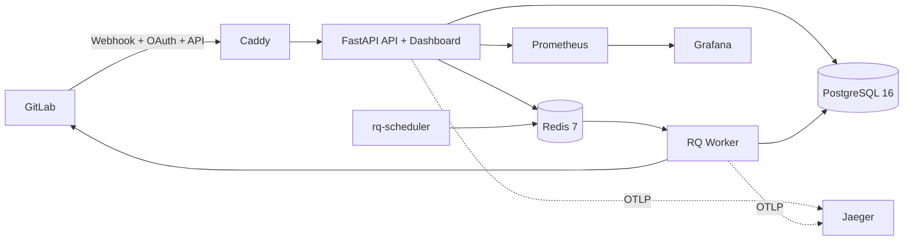

# 00 - System Audit (2026-02-15)

> Full repository scan completed on **2026-02-15**.
> This report is generated from the current codebase state and used as the baseline for documentation updates.

## 1. Scope

Scanned areas:

- application code: `src/app/*`
- deployment and runtime: `docker-compose.yml`, `Dockerfile*`, `Caddyfile`, `.env.example`
- quality and pipeline: `.gitlab-ci.yml`, `pyproject.toml`, `tests/*`
- observability: `monitoring/*`
- documentation: `README*`, `docs/*`, `docs-site/docs/*`

## 2. Inventory Snapshot

| Domain | Count | Notes |
|---|---:|---|
| API files (`src/app/api`) | 66 | Includes route modules and helpers |
| Service files (`src/app/services`) | 57 | Business logic + GitLab integrations |
| Worker files (`src/app/workers`) | 68 | Queue processing + scheduler |
| Model files (`src/app/models`) | 81 | ORM models and support files |
| Schema files (`src/app/schemas`) | 57 | Request/response DTOs |
| Security files (`src/app/security`) | 24 | Auth, CSRF, token handling |
| Template files (`src/app/templates`) | 106 | HTML templates and components |
| Root docs markdown files (`docs/*.md`) | 23 | Engineering/internal docs |
| Docs-site markdown files (`docs-site/docs/*.md`) | 80 | Published SK/EN docs content |
| Unit tests (`tests/unit/*.py`) | 60 | Core regression coverage |
| Integration tests (`tests/integration/*.py`) | 4 | API/system behavior |
| Load tests (`tests/load/*.py`) | 2 | Locust load profile |

## 3. Route Scan Summary

Total discovered route handlers: **174**.

| Module | Route count |
|---|---:|
| `dashboard.py` | 59 |
| `telemetry.py` | 18 |
| `courses.py` | 16 |
| `rubrics.py` | 11 |
| `teams.py` | 7 |
| `students.py` | 5 |
| `projects.py` | 5 |
| `sync.py` | 4 |
| `users.py` | 4 |
| `events.py` | 3 |
| `llm.py` | 2 |
| `reports.py` | 2 |
| `sse.py` | 2 |
| `docker_verify.py` | 1 |
| `gitlab_parse.py` | 1 |
| `webhooks.py` | 1 |

## 4. Architecture Baseline



## 5. Documentation Gaps Found During Scan

Primary inconsistencies found before update:

1. docs-site API pages described JWT + `/auth/login`, while runtime uses static bearer token and GitLab OAuth session.
2. docs-site monitoring pages referenced components not present in compose runtime (e.g., Loki/Alertmanager stack).
3. architecture pages used outdated scheduler/runtime naming in several sections.
4. changelog entries contained stale roadmap items and historical claims conflicting with current implementation.
5. root docs and docs-site language quality/consistency varied across SK/EN pages.

## 6. Remediation Performed

Updated documentation artifacts:

- `README.md`
- `README.sk.md`
- `docs-site/docs/index.md`
- `docs-site/docs/index.en.md`
- `docs-site/docs/uvod/index.md`
- `docs-site/docs/uvod/index.en.md`
- `docs-site/docs/uvod/architektura.md`
- `docs-site/docs/uvod/architektura.en.md`
- `docs-site/docs/api/index.md`
- `docs-site/docs/api/index.en.md`
- `docs-site/docs/operatori/monitoring.md`
- `docs-site/docs/operatori/monitoring.en.md`
- `docs-site/docs/operatori/nasadenie.md`
- `docs-site/docs/operatori/nasadenie.en.md`
- `docs-site/docs/vyvojari/index.md`
- `docs-site/docs/vyvojari/index.en.md`
- `docs-site/docs/changelog.md`
- `docs-site/docs/changelog.en.md`

## 7. Quality Baseline for Future Doc Changes

Always verify against these files before documenting behavior:

- API contracts: `src/app/api/*`, `src/app/schemas/*`
- auth and security: `src/app/dependencies.py`, `src/app/security/*`
- runtime and deployment: `docker-compose.yml`, `.env.example`, `Caddyfile`
- observability: `src/app/observability/*`, `monitoring/*`
- CI gates: `.gitlab-ci.yml`, `pyproject.toml`

Suggested pre-merge docs sanity commands:

```bash
ruff check src tests
ruff format --check src tests
mypy src/app
pytest tests/unit -q
```
